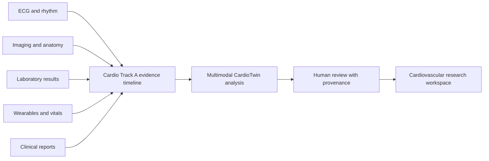
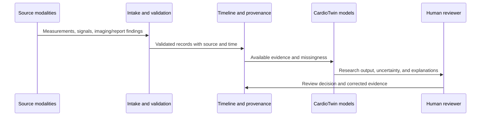
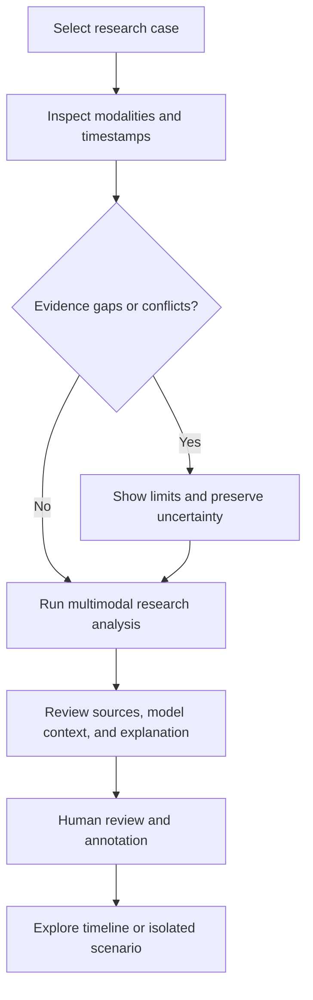
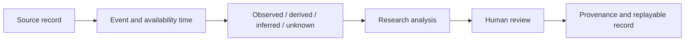
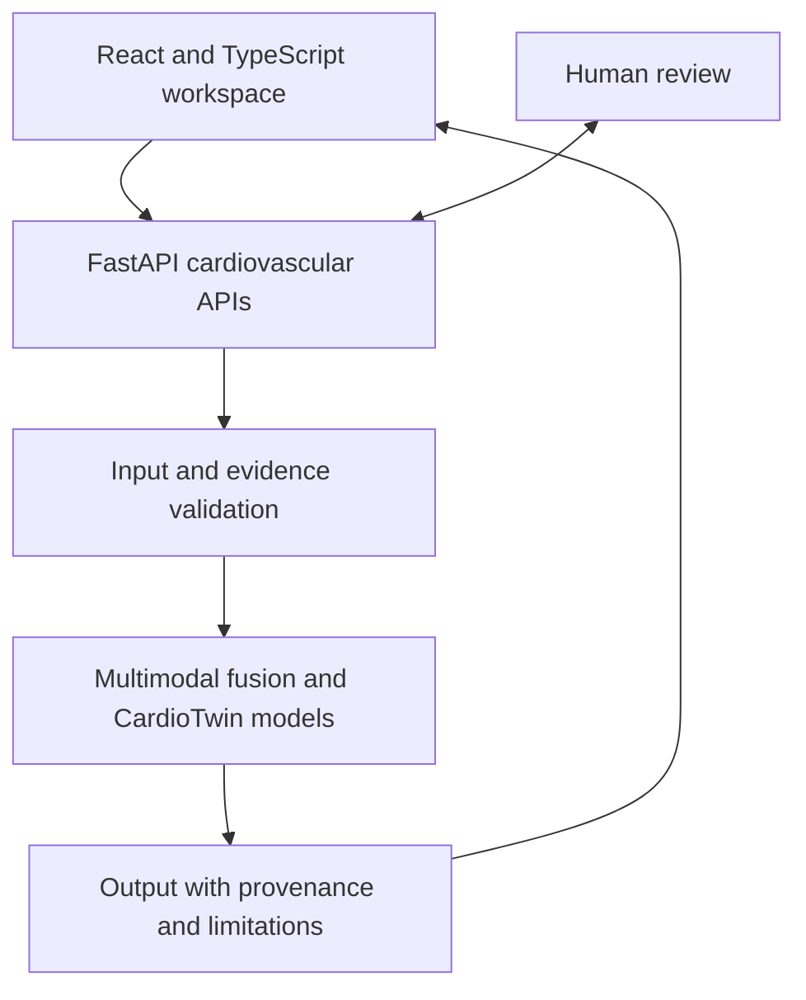

# CARDIOTON

## Cardio Track A · Multimodal Hackathon

CARDIOTON is a cardiovascular research and clinical-support prototype for **Cardio Track A**, a multimodal hackathon track focused on bringing different kinds of heart-health evidence into one reviewable cardiovascular picture. It combines structured clinical measurements, ECG and wearable signals, imaging and report findings, longitudinal timelines, and contextual data while keeping source, time, uncertainty, and reviewer decisions visible.

The project is built with React, TypeScript, Three.js, and FastAPI. Its CardioTwin workspace demonstrates multimodal fusion, cardiovascular risk research, longitudinal hemodynamic views, report review, reference anatomy, and evidence provenance. The hackathon presentation is about Cardio Track A and this cardiovascular system.

**Repository:** [victrvondoom/cardioton](https://github.com/victrvondoom/cardioton)

[](https://github.com/victrvondoom/cardioton/actions/workflows/ci.yml)

> **Research boundary:** CARDIOTON is not a diagnostic device or a clinically validated product. Demonstrations use synthetic or research data. Outputs support exploration and human review; they do not establish a diagnosis, patient-specific anatomy, treatment benefit, or a clinical recommendation.

## Cardio Track A — Multimodal Hackathon

Cardiovascular evidence is spread across modalities. An ECG captures electrical activity, imaging describes anatomy and function, laboratory values add physiological context, wearables provide repeated measurements, and clinical reports explain what a care team observed. These sources can differ in format, coverage, timing, confidence, and meaning.

Cardio Track A demonstrates how those inputs can be brought together while preserving where each item came from and what it can support. The system aligns records on a timeline, summarizes available modalities, makes missing or conflicting evidence visible, and presents model output with an explanation and a path for human review. The goal is a clearer, traceable cardiovascular evidence view—not automated clinical decision-making.



## Start here

| Goal | Entry point |
|---|---|
| Explore coronary CardioTwin | `/cardiotwin` |
| Explore multimodal cardiovascular evidence | `/cardiotwin/atlas` |
| Review cardiovascular reports | `/cardiotwin/intelligence` |
| Explore longitudinal hemodynamic views | `/cardiotwin/hemo` |
| Inspect system architecture | `/architecture` |
| Run the local application | See [Run locally](#run-locally) |

## Cardiovascular workspace

| Area | What it demonstrates |
|---|---|
| Coronary CardioTwin | Research estimates for CAD and vessel stenosis, with input integrity and scenario context |
| Multimodal CardioTwin | Evidence fusion across supported structured and signal inputs, with missingness and source context |
| CardioTwin Atlas | Shared cardiovascular timeline, evidence graph, spatial context, and isolated hypothetical scenarios |
| Cardio-Hemo Twin | Longitudinal cardiovascular state summaries, transitions, explanations, and historical replay |
| Cardiovascular intelligence | PDF, text, and FHIR report review; source excerpts; corrections; reviewer approval; exportable provenance |
| Reference anatomy | Generic heart anatomy with illustrative overlays, selection and cutaway controls, and text alternatives |
| Model evaluation | Reproducible research evaluation of the included cardiovascular models |

## Multimodal CardioTwin

The multimodal workflow accepts supported clinical and research signals and produces an evidence summary with model context. Inputs may include structured measurements, ECG or wearable features, report-derived findings, and longitudinal observations. The available output depends on the fields present; unavailable modalities remain absent rather than being silently fabricated.



The fusion layer is a research implementation. A fused score does not guarantee that every modality contributed, that inputs are clinically comparable, or that the estimate generalizes to a new population. Review the original evidence and model context before interpreting a result.

## Cardio Track A demo flow

1. Open the cardiovascular workspace and select a supported synthetic or research case.
2. Inspect the available modalities, timestamps, source records, and any missing or conflicting values.
3. Review the multimodal summary and model output alongside the evidence that contributed to it.
4. Correct or annotate report findings when needed; preserve the source and reviewer decision.
5. Explore timeline replay or a hypothetical scenario without changing the original evidence record.



## Evidence, review and provenance

Cardiovascular replay respects both when an event occurred and when its evidence became available (`event_at` and `available_at`). Report replay also respects reviewer-decision time. Views distinguish **OBSERVED**, **DERIVED**, **INFERRED**, and **UNKNOWN** information and retain source records and reviewer decisions. Missing or conflicting evidence remains visible.

Generic reference anatomy is illustrative and does not reconstruct an individual patient's heart. Environmental context does not establish patient exposure or causation. Hypothetical scenarios do not overwrite the source reconstruction. Evidence integrity checks describe recorded bytes and decisions, not clinical truth.



## Architecture and model governance

The web client presents cardiovascular workflows and calls the FastAPI backend. Backend services validate inputs, assemble evidence context, run the available research models, and return outputs with supporting metadata. The system keeps source evidence and reviewer decisions separate from generated analysis.



Model probabilities, proxy measurements, nominal geometry, and assumed uncertainty parameters are exploratory. They do not establish calibrated clinical performance, measured patient flow, causal treatment effects, or verified treatment recommendations. Human review remains necessary.

## Run locally

Use the repository's existing setup instructions and environment configuration. Do not commit local `.env` files or credentials.

```powershell
# Backend (from the repository root)
backend\.venv\Scripts\python.exe -m uvicorn app.main:app --app-dir backend --reload

# Frontend (in another terminal)
cd frontend
npm install
npm run dev
```

Configure only the providers and services needed for the workflow you are exploring. Synthetic/offline demonstrations do not require live clinical integrations.

## Verification

Run checks from the repository root and the frontend directory as appropriate:

```powershell
backend\.venv\Scripts\python.exe -m pytest backend/tests -q
backend\.venv\Scripts\python.exe -m ruff check backend/app backend/tests backend/scripts
cd frontend
npm test -- --run
npm run typecheck
npm run build
```

Live-provider, PostgreSQL integration, hosted deployment, and clinical validation require separate environments and evidence. Passing local software checks does not demonstrate clinical readiness.

## Research scope and limits

Cardio Track A presents a multimodal cardiovascular research workflow with traceable inputs, time-aware replay, model context, and human review. This repository does not claim prospective clinical accuracy, regulatory clearance, official interoperability certification, a production deployment, or clinical use. Evaluation on representative, appropriately governed cohorts and independent clinical review would be required before making those claims.

## License

See [LICENSE](LICENSE) for the project terms. Public repository access does not grant additional usage or redistribution rights.
