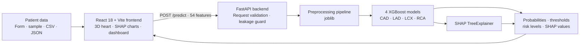

<div align="center">

# 🫀 AortaVision 3D

### Explainable coronary artery disease risk prediction, mapped onto an interactive 3D heart

Predict **overall CAD** and **LAD / LCX / RCA stenosis** from routine clinical data, see the risk painted directly onto a rotatable 3D heart, and understand *why* with SHAP.


[](https://gitdiagram.com/abishek-kk/aortavision-3d?utm_source=readme&utm_medium=badge)

**Demo video:** `<YOUTUBE_LINK>`

</div>

> ## ⚠️ Clinical safety disclaimer
>
> AortaVision 3D is a **research prototype for decision support and educational purposes only**.
> It is **not** a medical device and is **not** a substitute for formal diagnostic imaging
> (coronary angiography, CT angiography) or the judgment of a qualified clinician.
> Artery positions in the 3D scene are **schematic**; they are not an imaging-based lesion map.

---

## Table of contents

1. [Why this project](https://claude.ai/chat/45c7aba8-a5dd-453c-97d5-e09ec310240c#why-this-project)
2. [Key features](https://claude.ai/chat/45c7aba8-a5dd-453c-97d5-e09ec310240c#key-features)
3. [How it works](https://claude.ai/chat/45c7aba8-a5dd-453c-97d5-e09ec310240c#how-it-works)
4. [Quick start](https://claude.ai/chat/45c7aba8-a5dd-453c-97d5-e09ec310240c#quick-start)
5. [Using the app](https://claude.ai/chat/45c7aba8-a5dd-453c-97d5-e09ec310240c#using-the-app)
6. [Machine learning pipeline](https://claude.ai/chat/45c7aba8-a5dd-453c-97d5-e09ec310240c#machine-learning-pipeline)
7. [Results](https://claude.ai/chat/45c7aba8-a5dd-453c-97d5-e09ec310240c#results)
8. [Explainability](https://claude.ai/chat/45c7aba8-a5dd-453c-97d5-e09ec310240c#explainability)
9. [3D visualization](https://claude.ai/chat/45c7aba8-a5dd-453c-97d5-e09ec310240c#3d-visualization)
10. [API reference](https://claude.ai/chat/45c7aba8-a5dd-453c-97d5-e09ec310240c#api-reference)
11. [Project structure](https://claude.ai/chat/45c7aba8-a5dd-453c-97d5-e09ec310240c#project-structure)
12. [Reproducing the results](https://claude.ai/chat/45c7aba8-a5dd-453c-97d5-e09ec310240c#reproducing-the-results)
13. [Extending the system](https://claude.ai/chat/45c7aba8-a5dd-453c-97d5-e09ec310240c#extending-the-system)
14. [Limitations](https://claude.ai/chat/45c7aba8-a5dd-453c-97d5-e09ec310240c#limitations)
15. [Credits and licence](https://claude.ai/chat/45c7aba8-a5dd-453c-97d5-e09ec310240c#credits-and-licence)

---

## Why this project

Cardiovascular disease remains a leading cause of death worldwide. Risk models usually return a bare percentage, which tells a clinician or patient *how much* risk there is but not *where* the disease is developing or *what is driving it*.

AortaVision 3D closes that gap. It takes clinical, ECG, laboratory and echocardiographic measurements, predicts disease for four targets, and shows the answer on a 3D heart where each coronary artery changes colour with its predicted stenosis probability. Every prediction comes with a SHAP explanation and a breakdown of the patient's measurements against reference ranges.

## Key features

Capability
What you get

**Multi-target prediction**
Four XGBoost classifiers: overall **CAD**, plus **LAD**, **LCX** and **RCA** stenosis

**Leakage-safe inputs**
`CAD`, `LAD`, `LCX`, `RCA` and `Cath` are never model inputs. The training code excludes them and the API rejects them with HTTP 422

**Interactive 3D heart**
React Three Fiber scene: drag to rotate, scroll or pinch to zoom, hover for probability, click to pin vessel detail, fullscreen mode

**Live colour mapping**
Each coronary artery is coloured from its predicted probability: green (< 50%), yellow (50–70%), red (> 70%)

**Consistent vessel keys**
The same `CAD / LAD / LCX / RCA` keys drive the model, the 3D meshes, the SHAP tabs and the dashboard cards

**Clinical dashboard**
Predicted CAD status, per-vessel probabilities and risk levels, decision thresholds, validation metrics

**Interpretability**
SHAP feature contributions for each target, with red bars raising risk and blue bars lowering it

**Physiological breakdown**
Each measurement shown with its value, reference range and contribution to the prediction

**Flexible input**
Manual form, sample patients (High / Low / Borderline risk), or a one-row CSV / JSON upload

**Printable report**
Export the analysis, including a snapshot of the 3D heart, to PDF

**Always-visible disclaimers**
Persistent banner, first-visit modal and a note on the printed report

**Runs without a GPU**
Low-poly ~150 KB GLB model and no post-processing effects

## How it works



1. The frontend sends the 54 raw clinical features to `POST /predict`.
2. The backend validates them, applies the saved preprocessing pipeline, and runs the four models.
3. It returns probabilities, per-target thresholds, risk levels and SHAP contributions in one response.
4. The frontend recolours the three arteries, fills the dashboard and renders the explanations.

---

## Quick start

### Prerequisites

Requirement
Version

Python
3.10 or newer

Node.js (with npm)
18 or newer

GPU
Not required

Trained model weights are included in `model/serialized/`, so **you do not need to train anything to run the app.**

### 1. Start the backend (port 8000)

```
cd backend
python -m venv .venv
source .venv/bin/activate            # Windows: .venv\Scripts\activate
pip install -r requirements.txt
uvicorn aortavision_3d__backend__main:app --reload --port 8000
```

Verify it is running:

- Health check: [http://localhost:8000/health](http://localhost:8000/health) → `{"status":"healthy"}`
- Interactive API docs: [http://localhost:8000/docs](http://localhost:8000/docs)

### 2. Start the frontend (port 5173)

Open a second terminal:

```
cd frontend
cp .env.example .env                 # contains VITE_API_URL=http://localhost:8000
npm install
npm run dev
```

Open **[http://localhost:5173](http://localhost:5173/)**.

### 3. Run the tests and a production build (optional)

```
# from the repository root
pip install pytest httpx
python -m pytest backend/test_backend.py

cd frontend && npm run build
```

### Configuration

Variable
Where
Default
Purpose

`VITE_API_URL`
`frontend/.env`
`http://localhost:8000`
Backend URL used by the frontend

`FRONTEND_ORIGIN`
`backend/.env`
`http://localhost:5173,http://127.0.0.1:5173`
Allowed CORS origin(s), comma-separated

`AORTAVISION_MODEL_DIR`
backend environment
`model/serialized`
Override the model artifact folder

### Deploying

The frontend is a static site and can be hosted on Netlify using the included `netlify.toml` (base `frontend`, build `npm run build`, publish `dist`, with a single-page-app redirect). Netlify does **not** host the FastAPI backend, so deploy the backend separately, then set `VITE_API_URL` on the frontend host to the backend's public URL and set `FRONTEND_ORIGIN` on the backend to the frontend's URL. Redeploy the frontend after changing `VITE_API_URL`.

---

## Using the app

1. Open the app and accept the disclaimer.
2. On the home page, pick **Use sample patient data** (High Risk, Low Risk or Borderline), or upload a **CSV** (exactly one row) or **JSON** file containing the 54 raw feature names.
3. Click **Analyze**.
4. On the analysis page:

- **Rotate** the heart by dragging and **zoom** with scroll or pinch.
- **Hover** an artery to see its probability. **Click** it to pin its detail card.
- Use the **SHAP tabs** (CAD / LAD / LCX / RCA) to see what drove each prediction. Selecting a vessel also switches the SHAP view to it.
- Read the **physiological table** for value, reference range and contribution per measurement.
- Review the **validation metrics** panel.
- Click **Export Report** to print or save a PDF.

The **Guide** page explains the clinical terms and the **About** page summarises the method.

---

## Machine learning pipeline

### Dataset

- **Source:** Extension of the Z-Alizadeh Sani coronary artery disease dataset (UCI Machine Learning Repository), stored in `dataset/dataset.csv`.
- **Size:** 378 patient records, 59 columns, no missing values, no exact duplicate rows.
- **Inputs (54 raw features):** demographics, history and risk factors, vitals and examination, symptoms, ECG findings, laboratory values and echocardiography (for example Age, BMI, BP, PR, FBS, LDL, HDL, ST elevation / depression, T inversion, LVH, EF-TTE, Region RWMA).
- **Targets:**

Target
Positive class
Positive
Negative

`CAD`
derived from `Cath == CAD`
291
87

`LAD`
Stenotic
238
140

`LCX`
Stenotic
189
189

`RCA`
Stenotic
189
189

Full column descriptions are in [`dataset/data_dictionary.md`](https://claude.ai/chat/dataset/data_dictionary.md) and the audit is in [`dataset/data_quality_report.md`](https://claude.ai/chat/dataset/data_quality_report.md).

### Leakage control

`CAD`, `LAD`, `LCX`, `RCA` and `Cath` are excluded from the input features for every model. This is enforced in three places: the training code, the saved feature list (`model/serialized/feature_names.json`), and the API, which returns HTTP 422 if any of these fields appear in a request.

### Preprocessing

Step
Detail

Cleaning
Unambiguous label fixes (`Fmale → Female`, `mild → Mild`)

Removed feature
`Exertional CP` (constant in the data)

Numeric features
Median imputation, then `RobustScaler`

Categorical features
Most-frequent imputation, then one-hot encoding (unknown categories ignored)

Fitting
Preprocessors are fitted on training data only

Class balancing
SMOTE applied **inside** the training pipeline for CAD, never to validation data

Two data-quality observations were kept rather than silently altered: one row where `Cath` and the vessel labels disagree, and one extreme triglyceride value (> 1000). Both are documented in the data-quality report.

### Models

One XGBoost binary classifier per target, each with its own regularization strategy and decision threshold:

Target
Strategy
Decision threshold

CAD
SMOTE + regularized XGBoost
0.35

LAD
Very regularized XGBoost
0.30

LCX
Regularized XGBoost
0.25

RCA
Very regularized XGBoost
0.35

Thresholds are chosen to **maximize F1 on out-of-fold predictions from the training split only**, searched over 0.20–0.70. Ties favour higher recall. The holdout set is never used to choose a threshold or a model. See [`metrics/threshold_report.md`](https://claude.ai/chat/metrics/threshold_report.md).

Because a missed stenosis is costlier than a false alarm in a screening setting, the operating points favour **sensitivity over specificity**.

### Validation methodology

- **Headline estimate:** 5-fold stratified cross-validation repeated 10 times (seed 42), with preprocessing fitted inside each fold. Confidence intervals are percentile intervals over the 10 repeat-level means.
- **Holdout:** one fixed multi-label-balanced split (302 train / 76 test), reported separately and used for reporting only.
- **Also reported:** PR-AUC, Brier score, confusion matrices, ROC curves, threshold sweeps and an overfitting comparison.

---

## Results

### Repeated cross-validation (headline), mean ± SD

Target
Accuracy
Precision
Recall
F1
ROC-AUC

**CAD**
0.890 ± 0.008
0.908
0.956
0.931
**0.935 ± 0.005**

**LAD**
0.758 ± 0.005
0.738
0.957
0.833
**0.836 ± 0.009**

**LCX**
0.678 ± 0.009
0.620
0.930
0.743
**0.819 ± 0.009**

**RCA**
0.703 ± 0.010
0.640
0.932
0.758
**0.802 ± 0.009**

### Fixed holdout (n = 76, report only)

Target
Accuracy
Precision
Recall
F1
ROC-AUC

CAD
0.816
0.780
0.979
0.868
0.949

LAD
0.776
0.750
0.957
0.841
0.906

LCX
0.724
0.673
0.868
0.759
0.832

RCA
0.776
0.706
0.947
0.809
0.877

**Reading these numbers honestly:** CAD is predicted well. Vessel-level targets are harder, and LCX and RCA are the weakest. The high recall is a deliberate result of the low thresholds, and it comes with lower precision and specificity. The holdout is a small single split, so treat it as a sanity check rather than a competing estimate.

Supporting material:

What
Where

All metrics with 95% intervals
[`metrics/repeated_cv_summary.csv`](https://claude.ai/chat/metrics/repeated_cv_summary.csv)

Holdout metrics
[`metrics/classification_metrics.csv`](https://claude.ai/chat/metrics/classification_metrics.csv)

ROC curves
[`metrics/roc_curves/`](https://claude.ai/chat/metrics/roc_curves)

Confusion matrices
[`metrics/confusion_matrices/`](https://claude.ai/chat/metrics/confusion_matrices)

Threshold trade-off plots
[`metrics/thresholds/`](https://claude.ai/chat/metrics/thresholds)

Generalization and overfitting analysis
[`metrics/generalization_report.md`](https://claude.ai/chat/metrics/generalization_report.md)

How the numbers were produced
[`docs/CANONICAL_METRICS.md`](https://claude.ai/chat/docs/CANONICAL_METRICS.md)

Check that the numbers quoted here match the CSVs:

```
python scripts/check_metrics_consistency.py
```

---

## Explainability

Every prediction is explained with SHAP (`TreeExplainer`) for all four targets.

- **Per-patient explanation:** the API returns the top contributing features for each target, with the contribution value, its direction (`increases_risk` / `decreases_risk`) and the patient's actual value.
- **Dashboard view:** a horizontal bar chart per target. Red bars push risk up, blue bars push it down.
- **Physiological breakdown:** the table pairs each measurement with its reference range and its contribution to the prediction.
- **Global importance:** SHAP summary plots in [`explainability/shap/`](https://claude.ai/chat/explainability/shap) and feature-contribution tables in [`explainability/feature_contributions/`](https://claude.ai/chat/explainability/feature_contributions).

SHAP values describe what the **model** relied on. They are not causal claims about the patient's physiology.

---

## 3D visualization

- **Stack:** React Three Fiber, `@react-three/drei` and Three.js.
- **Heart model:** `frontend/public/models/aortavision_3d__public_models__heart.glb`, a low-poly web-optimised mesh (~150 KB). If it fails to load, the app falls back to a procedural heart so the dashboard still works.
- **Arteries:** LAD, LCX and RCA are tube meshes drawn over the heart. Their colour is computed from the predicted probability:

Probability
Colour
Level

< 50%
🟢 Green
Low

50–70%
🟡 Yellow
Moderate

> 70%
🔴 Red
High

- **Interaction:** orbit controls, hover tooltips, click-to-pin vessel cards, legend toggle and fullscreen.
- **Performance:** no post-processing and a small mesh keep interaction smooth on machines without a dedicated GPU.
- **Correspondence:** the model output, the mesh and the dashboard all use the same `LAD / LCX / RCA` keys, so a vessel can never be shown against the wrong prediction.

> The dashboard's *API* risk label uses 30% / 70% bands, while the 3D colour scale uses 50% / 70%. The colour scale is a visual cue only. The model's decision uses the per-target thresholds listed above.

---

## API reference

Base URL: `http://localhost:8000` · Interactive docs at `/docs`

Endpoint
Method
Purpose

`/health`
GET
Model and preprocessor load status

`/models/status`
GET
Per-target model information and thresholds

`/metrics`
GET
Repeated-CV and holdout metrics per target

`/predict`
POST
Probabilities, thresholds, risk levels and SHAP contributions

**Example request**

```
{
  "features": {
    "Age": 65, "Sex": "Male", "Weight": 78, "Length": 172, "BMI": 26.37,
    "DM": 1, "HTN": 1, "Current Smoker": 1, "EX-Smoker": 0, "FH": 1,
    "...": "all 54 raw features are required"
  }
}
```

**Example response (abridged)**

```
{
  "success": true,
  "predictions": {
    "CAD": { "probability": 0.852, "threshold": 0.35, "prediction": 1, "risk_level": "High" },
    "LAD": { "probability": 0.781, "threshold": 0.30, "prediction": 1, "risk_level": "High" }
  },
  "explanations": {
    "CAD": [
      { "feature": "Age", "contribution": 0.421, "direction": "increases_risk", "value": 65 }
    ]
  },
  "disclaimer": "This system is a research prototype ..."
}
```

Requests that include `CAD`, `LAD`, `LCX`, `RCA` or `Cath` are rejected with HTTP 422. The complete field list, encodings and response schema are in [`BACKEND_CONTRACT.md`](https://claude.ai/chat/BACKEND_CONTRACT.md).

---

## Project structure

```
AortaVision-3D/
├── backend/            FastAPI app (aortavision_3d__backend__main.py), request schema, tests
├── frontend/           React + Vite + Tailwind + React Three Fiber
│   ├── public/models/  aortavision_3d__public_models__heart.glb
│   └── src/            pages, components, services, config
├── model/
│   ├── aortavision_preprocessing.py   preprocessing and feature engineering
│   ├── notebooks/                     training and evaluation scripts
│   └── serialized/                    trained weights and preprocessor
├── dataset/            dataset, data dictionary, data-quality report
├── metrics/            CSVs, ROC curves, confusion matrices, threshold sweeps
├── explainability/     SHAP plots and feature-contribution tables
├── docs/               CANONICAL_METRICS.md
├── scripts/            metrics consistency check, mesh generation helper
├── BACKEND_CONTRACT.md API contract
└── netlify.toml        frontend deployment config
```

---

## Reproducing the results

The shipped weights are already in `model/serialized/`. To re-run the modelling code:

```
pip install -r model/requirements.txt

# quick smoke test of the training and evaluation framework
python model/notebooks/improve_metrics.py --repeats 1 --inner-folds 2 --trials 0
```

`RUN_PIPELINE.sh` and `RUN_PIPELINE.bat` wrap the same pipeline for Linux / macOS / WSL and Windows. Further notes are in `METRICS_IMPROVEMENT_GUIDE.md`.

Random seed is **42** throughout. The dataset hash and package versions used for the shipped models are recorded in `model/serialized/model_metadata.json`.

---

## Extending the system

The architecture is built so that growth does not require a redesign.

To add…
Do this

**A clinical feature**
Add it to the feature config and the reference ranges in `frontend/src/config/referenceRanges.js`, add it to the backend schema, and retrain

**A prediction target or vessel**
Add a model target and a matching mesh entry in the 3D scene. The shared key links them automatically

**A different model**
Replace the file in `model/serialized/`. The API and dashboard read probabilities and SHAP in a model-agnostic format

**A different anatomy mesh**
Drop a `.glb` into `frontend/public/models/` and adjust the artery anchor positions

---

## Limitations

- **Single-centre, small dataset** (378 records). Results may not generalize to other hospitals or populations.
- **No external validation.** Confidence intervals reflect resampling variability inside this dataset only.
- **Recall-oriented thresholds** cause more false positives, especially for LCX and RCA.
- **Schematic anatomy.** The dataset has no imaging data, so artery positions are illustrative and do not represent real lesion locations.
- **Tabular inputs only.** `Region RWMA` and other echo features are used as clinical inputs, not as spatial maps.
- **Not clinically validated.** Do not use this system to make or delay any medical decision.

---


## Credits and licence

**Data:** Z-Alizadeh Sani coronary artery disease dataset, UCI Machine Learning Repository.

**Libraries:** XGBoost, scikit-learn, imbalanced-learn, SHAP, pandas, NumPy, FastAPI, Pydantic, Uvicorn, React, Vite, Tailwind CSS, Three.js, React Three Fiber, drei, Recharts, Papa Parse, Lucide.


---

<div align="center">
**AortaVision 3D** · For decision support and education only · Not a substitute for diagnostic imaging

</div>
