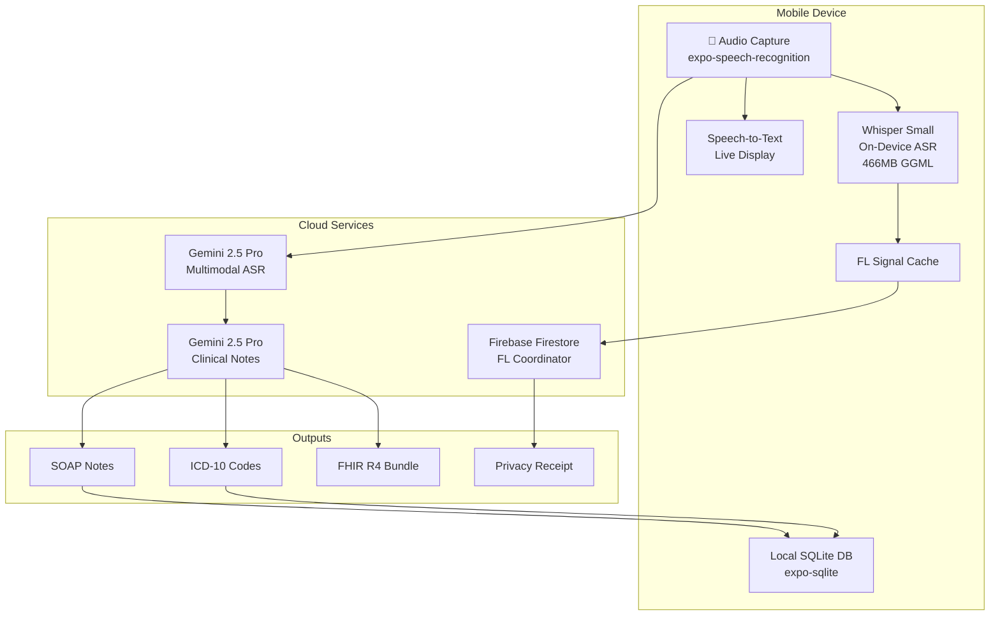
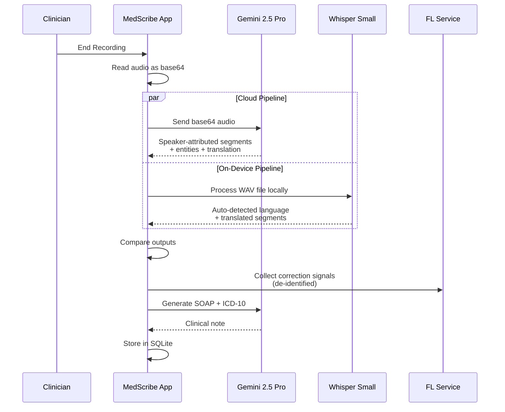
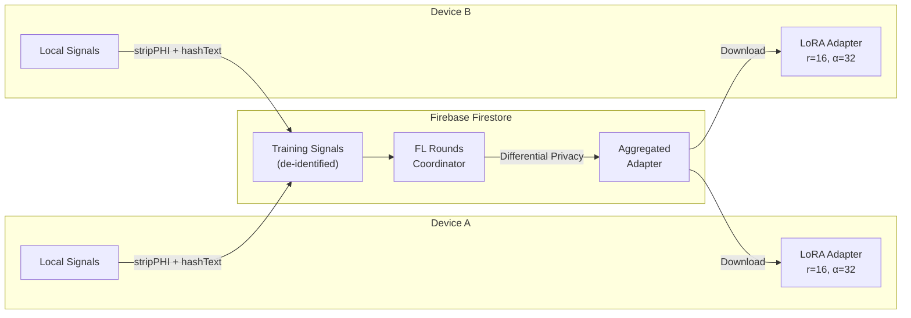
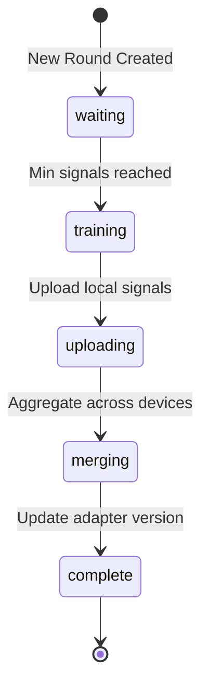
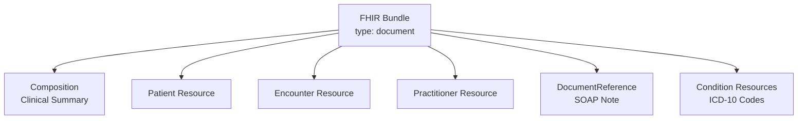
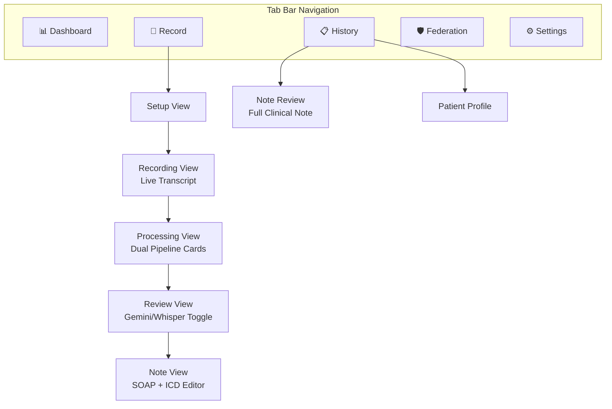
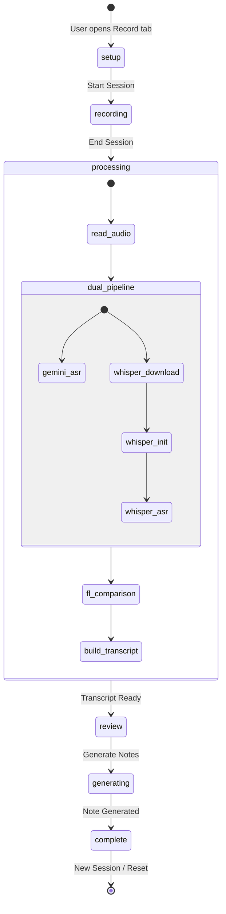

# MedScribe — Executive Technical Document

**Version 1.0** · **February 2026** · **Confidential**

---

## 1. Executive Summary

MedScribe is a **HIPAA-aware, AI-powered clinical documentation platform** for healthcare providers. It captures doctor-patient conversations in real-time, transcribes them using a **dual AI pipeline** (cloud + on-device), generates clinical notes in **SOAP format** with **ICD-10 codes**, and continuously improves through **Federated Learning** — all while preserving patient privacy.

### Key Differentiators

| Capability | Description |
|---|---|
| **Dual Transcription Pipeline** | Gemini 2.5 Pro (cloud) + Whisper Small (on-device) run in parallel |
| **Federated Learning** | Model improves across devices without sharing patient data |
| **99-Language Auto-Detection** | Whisper auto-detects and translates mixed-language conversations |
| **FHIR R4 Interoperability** | Generates HL7 FHIR R4 compliant clinical documents |
| **Differential Privacy** | Gaussian noise injection with ε-budget tracking |
| **Real-time NER** | Extracts symptoms, medications, conditions, vitals, procedures |
| **Offline Capable** | Whisper transcription works without internet |

---

## 2. System Architecture



### Component Overview

| Component | Technology | Lines of Code | Purpose |
|---|---|---|---|
| **Gemini AI Service** | Gemini 2.5 Pro API | 551 | Transcription, SOAP notes, ICD-10, translation |
| **Whisper ASR** | whisper.rn (GGML) | 172 | On-device transcription, auto language detection |
| **FL Service** | Firebase Firestore | 609 | Federated learning, privacy, adapter management |
| **FHIR Generator** | HL7 FHIR R4 | 340 | Standards-compliant clinical documents |
| **Database** | expo-sqlite | 515 | Local session, note, and audit storage |
| **Session Hook** | React Native | 624 | Session lifecycle, dual pipeline orchestration |
| **5 Tab Screens** | Expo Router | ~3,800 | Dashboard, Record, History, Federation, Settings |

---

## 3. Dual Transcription Pipeline

MedScribe employs a **parallel dual-pipeline architecture** where two independent ASR systems process the same audio simultaneously:



### 3.1 Gemini 2.5 Pro — Cloud Pipeline (Primary)

**File:** [gemini.ts](file:///d:/AxxessRecord/medscribe/src/modules/ai/gemini.ts)

The primary transcription pipeline uses Google's Gemini 2.5 Pro multimodal model:

| Feature | Detail |
|---|---|
| **Input** | Base64-encoded WAV audio |
| **Speaker Attribution** | Identifies `DR` (Doctor) and `PT` (Patient) speakers |
| **Entity Extraction** | Symptoms, medications, conditions, vitals, procedures, durations |
| **Translation** | Auto-translates non-English speech to English |
| **Confidence Scoring** | Per-segment confidence values (0-1) |
| **Timestamps** | Start/end millisecond timestamps per segment |

**Capabilities:**
- `transcribeAudio()` — Full multimodal ASR with entities and speaker detection
- `transcribeAudioFast()` — Minimal prompt for 2-3x faster transcription
- `refineTranscript()` — Periodic refinement pass for medical terminology
- `translateText()` — Context-aware medical translation
- `generateClinicalNote()` — Full SOAP note with ICD-10, vitals, medications, risk factors

### 3.2 Whisper Small — On-Device Pipeline (Secondary)

**File:** [whisper.ts](file:///d:/AxxessRecord/medscribe/src/modules/ai/whisper.ts)

The secondary pipeline uses OpenAI's Whisper model running entirely on-device:

| Feature | Detail |
|---|---|
| **Model** | `ggml-small.bin` (466MB, HuggingFace GGML format) |
| **Language Detection** | Auto-detects from 99 languages (first 30s of audio) |
| **Translation** | Always translates to English for FL comparison |
| **Mixed Language** | Handles code-switching and partial language mixing |
| **Privacy** | Audio never leaves the device |
| **Offline** | Works without internet connectivity |
| **Auto-Download** | Downloads model on first use with progress display |
| **Timeout** | 30-second initialization timeout prevents hangs on low-RAM devices |

**Lifecycle:**
1. **Download**: Auto-downloads `ggml-small.bin` (~466MB) from HuggingFace on first use
2. **Initialize**: Loads the GGML model into a Whisper context
3. **Transcribe**: Processes the audio file with `language: 'auto'` and `translate: true`
4. **Compare**: Output compared with Gemini for FL training signal collection

### 3.3 Pipeline Comparison — Review Screen

After both pipelines complete, the user sees a **Pipeline Comparison Card** with:

| Metric | Gemini | Whisper |
|---|---|---|
| Speaker detection | ✓ | ✗ |
| Medical entity extraction | ✓ | ✗ |
| Timestamps | ✓ | ✓ |
| Translation | ✓ | ✗ |
| Privacy (on-device) | ✗ | ✓ |
| Works offline | ✗ | ✓ |

A **Gemini / Whisper toggle** lets clinicians switch between transcript sources for review.

---

## 4. Federated Learning Model

MedScribe implements **real Federated Learning (FL)** where transcription accuracy improves across all participating devices without sharing patient data.

**File:** [service.ts](file:///d:/AxxessRecord/medscribe/src/modules/fl/service.ts)

### 4.1 Architecture



### 4.2 Training Signal Collection

Signals are collected from **three sources**:

| Signal Type | Source | When Collected |
|---|---|---|
| `correction` | Whisper ↔ Gemini text diff | After dual pipeline completes |
| `low_confidence` | Segments with confidence < threshold | During transcription |
| `approved_transcription` | User approves clinical note | On note approval |

**De-identification Pipeline (HIPAA Compliant):**

```
Raw Text → stripPHI() → hashText() → Firebase Firestore
```

- `stripPHI()` removes: patient names, dates (MM/DD/YYYY), phone numbers, SSNs, addresses, ages, proper nouns
- `hashText()` generates SHA-256 hash of de-identified text
- Only hashed, de-identified correction pairs are uploaded

### 4.3 FL Round Lifecycle

Each FL round follows this lifecycle:



**Round Data Model ([FLRound](file:///d:/AxxessRecord/medscribe/src/modules/fl/service.ts#L99-L110)):**

| Field | Type | Purpose |
|---|---|---|
| `round_id` | number | Sequential round identifier |
| `status` | enum | waiting → training → uploading → merging → complete |
| `devices_participating` | number | Number of devices in this round |
| `sessions_contributed` | number | Total sessions used for training |
| `accuracy_before` | number | Pre-round model accuracy |
| `accuracy_after` | number | Post-round model accuracy |
| `delta_size_kb` | number | Size of adapter delta update |
| `epsilon_consumed` | number | Privacy budget consumed |

### 4.4 Differential Privacy

MedScribe implements **Gaussian mechanism differential privacy**:

```typescript
function applyDifferentialPrivacy(gradients: number[], epsilon: number): number[] {
    const sensitivity = 1.0;
    const sigma = sensitivity / epsilon;
    return gradients.map(g => {
        const clipped = Math.max(-1.0, Math.min(1.0, g));  // Gradient clipping
        return clipped + gaussianNoise(0, sigma);            // Noise injection
    });
}
```

| Privacy Parameter | Value | Purpose |
|---|---|---|
| **Epsilon Budget** | 10.0 total | Total privacy budget across all rounds |
| **Per-Round ε** | ~0.3-0.5 | Privacy consumed per training round |
| **Clipping Norm** | 1.0 | Gradient clipping threshold |
| **Noise Multiplier** | σ = 1/ε | Gaussian noise standard deviation |

### 4.5 Privacy Receipt

After each FL round, a cryptographic **Privacy Receipt** is generated:

| Field | Purpose |
|---|---|
| `round_id` | Which FL round |
| `delta_size_kb` | How much data was shared |
| `epsilon_consumed` | Privacy budget used |
| `noise_multiplier` | How much noise was added |
| `clipping_norm` | Gradient clipping threshold |
| `items_not_transmitted` | List of fields NOT shared (audio, patient names, DOB, etc.) |
| `hash` | SHA-256 hash of the receipt for tamper detection |

### 4.6 LoRA Adapter Model

The FL system uses **Low-Rank Adaptation (LoRA)** for efficient on-device fine-tuning:

| Parameter | Value |
|---|---|
| **Rank** | 16 |
| **Alpha** | 32 |
| **Target Modules** | `q_proj`, `v_proj`, `out_proj`, `fc1`, `fc2` |
| **Trainable Parameters** | 294,912 |
| **Total Parameters** | 242,934,016 |
| **Compression Ratio** | 0.121% |

---

## 5. Clinical Note Generation

**File:** [gemini.ts](file:///d:/AxxessRecord/medscribe/src/modules/ai/gemini.ts#L117-L249)

When the clinician approves the transcript, Gemini 2.5 Pro generates a comprehensive clinical note:

### 5.1 Output Structure ([ClinicalNoteResult](file:///d:/AxxessRecord/medscribe/src/modules/ai/gemini.ts#L101-L113))

| Component | Description |
|---|---|
| **SOAP Note** | Subjective, Objective, Assessment, Plan |
| **ICD-10 Codes** | Up to 5 codes with confidence scores and primary flag |
| **Patient Summary** | 2-3 sentence clinical summary |
| **Vitals** | Extracted vital signs with reference ranges and status |
| **Medications** | Current, new, discontinued, modified medications |
| **Risk Factors** | Low/moderate/high/critical risk assessment |
| **Key Findings** | Highlighted clinical findings |
| **Differential Diagnoses** | Alternative diagnostic considerations |
| **Follow-up** | Recommended follow-up days |
| **Urgency Level** | Routine / Urgent / Emergent |

### 5.2 Specialty-Aware Prompting

The clinical note prompt is tailored per specialty:

- **Cardiology**: ECG findings, chest pain characterization, cardiac risk factors
- **General**: Comprehensive ROS, preventive care screening
- **Hospice**: Pain management, advance directives, comfort measures
- **ER**: Triage classification, trauma assessment, disposition
- **Palliative**: Symptom burden, goals of care, family dynamics

---

## 6. FHIR R4 Interoperability

**File:** [generator.ts](file:///d:/AxxessRecord/medscribe/src/modules/fhir/generator.ts)

MedScribe generates **HL7 FHIR R4** compliant document bundles for EHR interoperability:

### Bundle Structure



| Resource | FHIR Type | Content |
|---|---|---|
| **Bundle** | `Bundle` (document) | Container with timestamp |
| **Composition** | `Composition` | Document sections (SOAP, ICD, transcript) |
| **Patient** | `Patient` | Patient name, language preference |
| **Encounter** | `Encounter` | Session duration, specialty (SNOMED CT coded) |
| **DocumentReference** | `DocumentReference` | Base64-encoded SOAP note text |
| **Condition** | `Condition` | ICD-10-CM coded diagnoses |

### Coding Systems

| System | Usage |
|---|---|
| **ICD-10-CM** | Diagnosis codes |
| **SNOMED CT** | Specialty and encounter types |
| **LOINC** | Document types |
| **BCP-47** | Patient language codes |

---

## 7. Data Architecture

### 7.1 Local Database (SQLite)

**File:** [axxess__modules_db__queries.ts](file:///d:/AxxessRecord/medscribe/src/modules/db/queries.ts)

| Table | Purpose | Key Fields |
|---|---|---|
| `sessions` | Recording sessions | patient_name, specialty, language, duration, status |
| `utterances` | Individual transcript segments | speaker, original_text, translated_text, entities_json |
| `notes` | Generated clinical notes | soap_json, icd_json, vitals_json, medications_json |
| `entities` | Extracted medical entities | text, type, confidence, utterance_id |
| `fl_logs` | Federated learning activity | round_id, signals_uploaded, adapter_version |
| `audit_logs` | HIPAA audit trail | event_type, description, metadata, timestamp |

### 7.2 Cloud Database (Firebase Firestore)

| Collection | Purpose |
|---|---|
| `training_signals` | De-identified correction pairs from all devices |
| `fl_rounds` | FL round metadata and coordination |
| `adapters` | Versioned LoRA adapter weights |
| `metrics` | Aggregated FL performance metrics |

---

## 8. Application Screens

### Navigation Structure



| Screen | File | Key Features |
|---|---|---|
| **Dashboard** | [index.tsx](file:///d:/AxxessRecord/medscribe/app/(tabs)/index.tsx) | Stats overview, recent sessions, AI model status, pull-to-refresh |
| **Record** | [session.tsx](file:///d:/AxxessRecord/medscribe/app/(tabs)/session.tsx) | 5-phase session lifecycle: setup → recording → processing → review → complete |
| **History** | [sessions.tsx](file:///d:/AxxessRecord/medscribe/app/(tabs)/sessions.tsx) | Search by patient/ICD/keyword, specialty filter chips, pull-to-refresh |
| **Federation** | [federation.tsx](file:///d:/AxxessRecord/medscribe/app/(tabs)/federation.tsx) | FL metrics dashboard, round history, privacy receipts, adapter info |
| **Settings** | [settings.tsx](file:///d:/AxxessRecord/medscribe/app/(tabs)/settings.tsx) | Model management, data retention, biometric lock, export |
| **Note Review** | [note-review.tsx](file:///d:/AxxessRecord/medscribe/app/note-review.tsx) | Full editable clinical note with SOAP, ICD, vitals, medications |
| **Patient Profile** | [patient-profile.tsx](file:///d:/AxxessRecord/medscribe/app/patient-profile.tsx) | Patient encounter history and clinical timeline |

---

## 9. Session Lifecycle

**File:** [useActiveSession.ts](file:///d:/AxxessRecord/medscribe/src/hooks/useActiveSession.ts)

The session hook orchestrates the entire recording-to-note pipeline:



### Phase Details

| Phase | What Happens | User Sees |
|---|---|---|
| **Setup** | Patient name, language, specialty selection | Setup form with specialty cards |
| **Recording** | Live speech-to-text via expo-speech-recognition | Waveform animation, live text bubbles, timer |
| **Processing** | Dual pipeline: Gemini + Whisper in parallel | Pipeline cards with progress bars |
| **Review** | Compare transcripts, toggle sources | Transcript bubbles, Gemini/Whisper toggle, diagnostics |
| **Complete** | SOAP note generated by Gemini | Editable SOAP fields, ICD codes, medications, vitals |

---

## 10. Technology Stack

### Core Platform

| Technology | Version | Purpose |
|---|---|---|
| **React Native** | 0.81.5 | Cross-platform mobile framework |
| **Expo** | 54.0 | Build toolchain and native modules |
| **Expo Router** | 6.0 | File-based tab navigation |
| **TypeScript** | 5.9 | Type-safe development |

### AI & ML

| Technology | Purpose |
|---|---|
| **Gemini 2.5 Pro** | Cloud ASR, clinical notes, translation, entity extraction |
| **whisper.rn** (0.5.5) | On-device ASR using GGML models |
| **Whisper Small** (466MB) | OpenAI's multilingual speech model |

### Data & Storage

| Technology | Purpose |
|---|---|
| **expo-sqlite** | Local clinical data storage |
| **Firebase Firestore** | FL signal coordination and adapter versioning |
| **AsyncStorage** | Settings and preferences |
| **expo-file-system** | Model file management |

### UI & UX

| Technology | Purpose |
|---|---|
| **React Native Reanimated** | Smooth animations (waveform, transitions) |
| **@expo/vector-icons** (Ionicons) | Consistent icon system |
| **expo-haptics** | Tactile feedback on interactions |
| **@shopify/flash-list** | High-performance session lists |

### Standards & Compliance

| Standard | Implementation |
|---|---|
| **HL7 FHIR R4** | DocumentReference, Composition, Patient, Encounter, Condition |
| **ICD-10-CM** | Diagnosis coding |
| **SNOMED CT** | Specialty and procedure coding |
| **LOINC** | Document classification |
| **HIPAA** | PHI stripping, audit logs, differential privacy |

---

## 11. Security & Privacy

### HIPAA Compliance Measures

| Measure | Implementation |
|---|---|
| **PHI De-identification** | `stripPHI()` removes names, dates, SSNs, phone numbers, addresses |
| **Text Hashing** | `hashText()` SHA-256 before any cloud upload |
| **Audit Logging** | All data operations logged with timestamps |
| **Differential Privacy** | Gaussian noise injection on training gradients |
| **Privacy Budget** | ε-budget tracking prevents excessive data exposure |
| **Privacy Receipts** | Cryptographic proof of what was/wasn't shared |
| **On-Device Processing** | Whisper runs entirely on-device, audio never transmitted |
| **Data Retention Controls** | Configurable auto-delete (30/60/90 days) |
| **Biometric Lock** | Optional device authentication |

### Data Flow Classification

| Data Type | Stored Locally | Sent to Cloud | De-identified |
|---|---|---|---|
| Raw audio | ✓ (temporary) | ✓ (Gemini API only) | N/A |
| Transcript text | ✓ (permanent) | ✗ | N/A |
| Clinical notes | ✓ (permanent) | ✗ | N/A |
| FL training signals | ✓ (cache) | ✓ (Firebase) | ✓ (stripPHI + hashText) |
| Patient names | ✓ (local only) | ✗ | N/A |
| ICD-10 codes | ✓ (permanent) | ✗ | N/A |

---

## 12. Codebase Structure

```
medscribe/
├── app/                          # Expo Router pages
│   ├── (tabs)/                   # Tab navigation
│   │   ├── _layout.tsx           # 5-tab layout configuration
│   │   ├── index.tsx             # Dashboard (stats, recent sessions)
│   │   ├── session.tsx           # Recording & processing (926 lines)
│   │   ├── sessions.tsx          # Session history with search
│   │   ├── federation.tsx        # FL dashboard & metrics
│   │   └── settings.tsx          # App settings & data management
│   ├── note-review.tsx           # Full clinical note viewer/editor
│   ├── patient-profile.tsx       # Patient encounter history
│   └── _layout.tsx               # Root layout
├── src/
│   ├── modules/
│   │   ├── ai/
│   │   │   ├── gemini.ts         # Gemini 2.5 Pro service (551 lines)
│   │   │   └── whisper.ts        # Whisper on-device ASR (172 lines)
│   │   ├── db/
│   │   │   ├── schema.ts         # SQLite schema definition
│   │   │   └── axxess__modules_db__queries.ts        # CRUD operations (515 lines)
│   │   ├── fhir/
│   │   │   └── generator.ts      # FHIR R4 bundle generator (340 lines)
│   │   └── fl/
│   │       └── service.ts        # Federated learning service (609 lines)
│   ├── hooks/
│   │   └── useActiveSession.ts   # Session lifecycle hook (624 lines)
│   ├── providers/
│   │   └── DatabaseProvider.tsx   # SQLite database context
│   ├── config/
│   │   └── firebase.ts           # Firebase configuration
│   └── types.ts                  # TypeScript type definitions
├── components/
│   └── ui/                       # Reusable UI components
├── constants/
│   ├── axxess__constants__theme.ts                  # Design system tokens
│   └── useThemeColors.ts         # Theme color hook
└── assets/
    └── images/                   # App icon, splash screen
```

**Total Codebase**: ~5,000+ lines of application logic across 15+ files

---

## 13. Deployment

### Build Process

```bash
# Generate native project from Expo config
npx expo prebuild --platform android

# Build release APK
cd android && ./gradlew app:assembleRelease -x lint -x test

# Output: android/app/build/outputs/apk/release/app-release.apk
```

### App Configuration ([app.json](file:///d:/AxxessRecord/medscribe/app.json))

| Setting | Value |
|---|---|
| **App Name** | MedScribe |
| **Bundle ID** | com.medscribe.app |
| **SDK** | Expo 54 |
| **Splash Background** | #4A0E1A (deep maroon) |
| **Adaptive Icon BG** | #8B1A2E (medical burgundy) |

---

## 14. Future Roadmap

| Feature | Priority | Description |
|---|---|---|
| **EHR Integration** | High | Direct FHIR R4 push to Epic, Cerner, AllScripts |
| **Whisper Large v3 Turbo** | Medium | When mobile RAM allows, upgrade for better accuracy |
| **rPPG Vitals Scanner** | Medium | Camera-based vital sign estimation |
| **Multi-Provider Sessions** | Medium | Support multiple clinicians in one encounter |
| **Adapter Marketplace** | Low | Specialty-specific LoRA adapters (cardiology, neuro, etc.) |
| **iOS Build** | High | Expo supports iOS — requires Apple Developer account |

---

> **Document generated from codebase audit — February 22, 2026**
> **MedScribe v1.0.0 · Built with Expo 54 · React Native 0.81.5**
