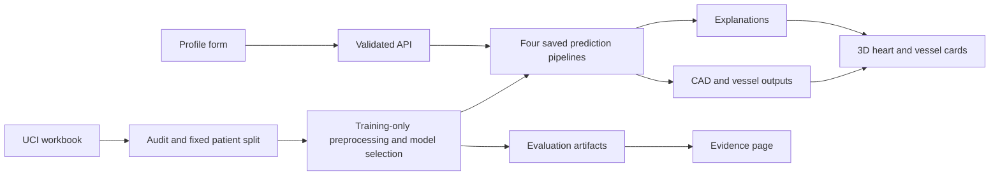

# CardioScope: Track A build and submission plan

**Decision:** Enter **Track A - Cardiovascular Risk Visualization & Prediction**.

**Product:** CardioScope, an interactive coronary-risk explorer combining trained classifiers, a real 3D heart, vessel-specific predictions, and explanations backed by reproducible evaluation.

**Plan date:** 1 October 2026. **Budget:** INR 0. **Team:** 2 people. **Human availability:** approximately 1-2 hours/day, conservatively treated as the team's combined review time. **Official submission deadline from the email:** 15 October 2026, 00:15 IST. **Our submission target:** 14 October, 18:00 IST.

This is the implementation plan; milestone status is recorded below. Measured development results are documented separately and do not alter the architecture or once-only final holdout rule. The complete application and final presentation remain unfinished.

**Phase-one status:** Project setup, source acquisition/audit, explicit feature/target contract, immutable holdout/nested CV, anatomy subset preparation, and app skeleton are implemented. See [development documentation](docs/DEVELOPMENT.md). Inspection found one original `Cath`/vessel-union label discrepancy and valid suffixed upstream FJ mesh IDs; the [source notes](docs/SOURCE_NOTES.md) document these minimal corrections. No model training, explanations, interactive rendering, or performance evaluation has been added.

**Phase-two status:** The real heart/LAD/LCX/RCA viewer now renders and supports source-based camera presets, bidirectional selection, isolation, orbit/zoom/reset, neutral styling and explicit failure handling. See [browser verification and measured render cadence](docs/anatomy/VERIFICATION.md). The locked data/split/anatomy artifacts remain unchanged; no model training, holdout evaluation or SHAP has run. The phase-one status above describes that earlier milestone.

**Phase-three status:** The predefined dummy/logistic/shallow-forest comparison is complete on the existing 242-record development partition and target-specific five-outer/three-inner folds. Four development configurations and pipelines are frozen; a full rerun reproduced every result and selection. See [development modeling documentation](docs/MODELING.md) for full metrics, weaknesses, timings, artifacts, and the minimal safe-loader correction. All locked source/data/anatomy artifacts remain unchanged. No holdout target decoding/evaluation, SHAP, calibration, prediction API integration, or UI risk coloring occurred.

**Phase-four status:** A dedicated evaluator and durable once-only guard were tested on synthetic fixtures before evaluating the four unchanged frozen pipelines exactly once on all 61 locked holdout records. Saved predictions reproduce all metrics, curves and uncertainty without another inference call. See [final evaluation documentation](docs/FINAL_EVALUATION.md) for the complete results, provenance and descriptive development comparison, including weak LCX/RCA recall. All Phase 1 inputs and Phase 3 artifacts remain byte-identical; no fitting, reselection, threshold change or calibration occurred. The completed guard refuses repeat evaluation. SHAP, application integration, patient form, model-driven coloring and submission work remain unfinished. Earlier milestone statements describe the state at those milestones.

**Phase-five status:** The exact evaluated pipelines now load after checksum/fingerprint/preprocessing verification and drive a strict 55-field form, one labeled development example, four independent numerical outputs and synchronized LAD/LCX/RCA coloring/selection. Stale requests/results are cancelled and rejected; numerical results remain available if 3D fails. All 113 Python and 54 frontend tests, safe data/anatomy/final-result verification, lint/type/build checks and real browser interaction passed. See [integration verification](docs/INTEGRATION.md) for latency, the small orbit-damping reset correction and preserved artifact checksums. No real fitting, holdout inference, model/threshold change, SHAP, calibration or final presentation work occurred in this phase.

**Phase-six status:** Verified positive-class explanations now use the exact frozen preprocessing/predictors: CAD/LAD LinearExplainer in model log-odds; LCX/RCA interventional probability-space TreeExplainer with a deterministic 100-record development reference. Every returned explanation reconstructs independently checked output and carries exact profile/model/schema/configuration identity. Original-feature grouping, signed bars, remaining-factor accounting, independent loading/errors, stale-response rejection and anatomy selection synchronization are implemented. See [explanation verification](docs/EXPLANATIONS.md) for tests, browser checks, latency, the SHAP routing/runtime corrections and unchanged frozen evidence. No model, calibration, threshold or evaluation was changed.


## 1. Why this track

Track A gives us the best balance of completion risk, visible quality, and demonstrable evidence under the actual budget and time constraints. This is an engineering judgment, not a calculated probability of winning: competitor quality and judge preferences are unknown.

| Track | Fit for our constraints | Main reason |
| --- | --- | --- |
| **A: cardiovascular risk** | **Best choice** | Small, available dataset; all required targets exist; CPU training; objective metrics; real coronary meshes; a strong visual demo without paid inference |
| **C: speech analytics** | Credible alternative | Classical audio analysis can run locally, but building and accurately labeling a good/flawed speech spectrum adds substantial recording and review work |
| **D: adaptive tutoring** | Higher delivery risk | Requires several accurate systems at once: transcription, figure understanding, grounded answers, verified question generation, grading, learner tracking, and evaluation; local tools do not remove those quality obligations |
| **B: flood mapping** | Highest delivery risk | Raw satellite preprocessing, historical OSM, damage mapping, road connectivity, and live evaluation on unseen areas/dates create the least predictable integration work |

We will spend effort in proportion to Track A's judging criteria, rather than adding unrelated features. Its model, visualization, and interpretation components account for **75%** of the score. [Track A brief](https://drive.google.com/file/d/1T9Whog4kWF3mYB7ZMGyihGWpbJBJtsfz/view?usp=sharing), p. 3.

| Judging criterion | Weight | Evidence we will show |
| --- | --- | --- |
| Predictive Performance | 30% | Four trained classifiers, baseline comparison, locked test results, per-target metrics and uncertainty |
| 3D Visualization | 25% | Real heart/coronary geometry, correct LAD/LCX/RCA selection, probability coloring, rotation/zoom/isolation |
| Clinical Interpretability | 20% | Positive-class explanations, measured inputs, signed feature contributions, explicit explanation units |
| System Integration | 15% | One profile drives all four predictions, matching vessel colors, selected-vessel details, and explanations |
| Technical Implementation | 10% | Pinned setup, persisted pipelines and weights, reproducible evaluation, clear source/asset provenance |

Our differentiation will be the completeness of the workflow: a judge can inspect a profile, select an artery, understand its prediction, and inspect the evidence supporting the model in the same app.

## 2. Feasibility already checked

### Dataset

The official [UCI ZIP](https://archive.ics.uci.edu/static/public/411/extention+of+z+alizadeh+sani+dataset.zip) was downloaded and its Excel workbook inspected on 1 October. It contains **303 records and 59 columns: 55 candidate predictors plus four target columns**. The first audit found **zero empty cells and zero exact duplicate rows**; unusual category values and possible patient duplication still need a detailed audit.

| Prediction | Source target | Positive class | Positive records | Negative records |
| --- | --- | --- | --- | --- |
| Overall CAD | `Cath` | `CAD` | 216 | 87 |
| LAD stenosis | `LAD` | `Stenotic` | 177 | 126 |
| LCX stenosis | `LCX` | `Stenotic` | 119 | 184 |
| RCA stenosis | `RCA` | `Stenotic` | 114 | 189 |

There is no separate `CAD` column. **`Cath` is the overall CAD target**, and all four target columns must be removed from every model's inputs. The vessel labels are binary; they do not encode percent narrowing or the location of a blockage.

The [UCI dataset page](https://archive.ics.uci.edu/dataset/411/extention%2Bof%2Bz%2B) states **CC BY 4.0**. Its citation credits **R. Alizadehsani, M. Roshanzamir, and Z. Sani (2013)**; dataset DOI: [10.24432/C5461K](https://doi.org/10.24432/C5461K).

Downloaded ZIP SHA-256: `e97af1a18733d64fa88caa0628e5fe7ce6b2e26ec4c7ee03baade92a6f1470e8`.

### Anatomy

The current [BodyParts3D archive](https://dbarchive.biosciencedbc.jp/en/bodyparts3d/download.html) supplies constituent OBJ meshes and mapping tables for the required structures. Actual mesh entries were inspected, not just searched by name.

| Structure | FMA concept | Representation | Constituent mesh mapping |
| --- | --- | --- | --- |
| Heart | `FMA7088` | `BP9305` | 83 listed leaf meshes |
| LAD / anterior interventricular branch | `FMA3862` | `BP9548` | 18 leaf meshes, including `FJ2631.obj` |
| LCX / circumflex branch | `FMA3895` | `BP9745` | 6 leaf meshes, including `FJ2649.obj` |
| RCA | `FMA50039` | `BP9299` | 29 listed leaf meshes, including `FJ2667.obj` |

Implementation must resolve **FMA concept -> constituent FJ meshes**. BP representation IDs are not OBJ filenames. Preserve the shared anatomical coordinate system, then center and scale the assembled model together. Remove coronary leaves from the base-heart group before rendering the separately colored arteries, to avoid duplicate geometry.

The [current archive license](https://dbarchive.biosciencedbc.jp/en/bodyparts3d/lic.html), updated 27 February 2025, states **CC BY 4.0**. The original BodyParts3D website still displays an older CC BY-SA 2.1 Japan notice. We will obtain assets from the current archive, retain its license/provenance, and preserve the required attribution. We will not apply one source's terms to unrelated downloads.

**Remaining anatomy gate:** Render the assembled groups, inspect their alignment and visibility, and verify that clicking each named vessel selects the intended anatomy. Geometry availability has been confirmed; visual accuracy has not yet been verified in the application.

### Compute and cost

The current machine has an ARM64 processor and **16 GB RAM**. The proposed classical models have no dedicated-GPU requirement. Initial downloads and dependency installation require internet; prediction and the recorded demonstration will run locally after setup. No paid APIs, GPU rental, hosted database, or paid hosting are needed.

## 3. What we will build

### The primary user journey

1. Open CardioScope and load a clearly labeled public-dataset example, or enter a profile.
2. Inspect inputs grouped into demographics, examination/vitals, laboratory, ECG, and echocardiographic measurements.
3. Run prediction and see **overall CAD status plus LAD, LCX, and RCA model-estimated probabilities**.
4. Rotate the heart, click an artery, and see the corresponding numerical prediction and explanation.
5. Inspect the inputs most associated with that model's output, including factors pushing it up or down. A **CAD / LAD / LCX / RCA selector** exposes explanations for all four targets, with CAD selected initially.
6. Open the evidence page to see how the models were evaluated, where they fail, and what the dataset can support.

The UI will keep the required educational/decision-support disclaimer visible. It will identify the anatomy as a reference model, not a reconstruction of the patient.

### Required scope

| Area | Implementation | Why it matters |
| --- | --- | --- |
| Four predictions | Separate binary classifiers for CAD, LAD, LCX, RCA | Directly satisfies the prediction requirement |
| Input workflow | Schema-driven grouped form, units where documented, allowed categories, validation, example loader | Makes the full feature set usable and prevents silent input errors |
| 3D anatomy | Heart with independently selectable coronary groups; orbit, zoom, reset, anterior/posterior views | Meets the 3D and spatial correspondence requirements |
| Risk display | Whole-vessel color, numerical probability, legend, selected-vessel card | Keeps anatomy and model output synchronized |
| Explanation | CAD/LAD/LCX/RCA selector; each row shows input value/category, documented unit, signed SHAP contribution; baseline and remaining-factor sum | Provides inspectable model reasoning |
| Evaluation page | Model comparison, all four target metrics, confusion matrices, calibration evidence, limitations | Supports judging and technical Q&A |
| Reproducibility | Trained artifacts, feature manifest, fixed splits, commands, dependency locks | Lets judges reproduce the project |

### Product boundaries

The model estimates the dataset's **existing CAD/stenosis labels**. We will not present it as a prediction of future heart attacks, percent lumen narrowing, a precise blockage location, or treatment effectiveness.

Four independent classifier probabilities are not a joint distribution. We will not derive overall CAD by multiplying artery probabilities or silently alter outputs to make them agree.

A complete public-data example is the fastest demo route. Manual entry will not silently substitute dozens of unentered values: if missing-value support is used, the UI will explicitly show which inputs were imputed and from what training-only rule. Unknown categories and malformed values will be rejected.

### Optional polish, only after the required workflow passes

- Side-by-side comparison of two complete profiles.
- An exportable prediction/explanation summary.
- A small gallery of correctly labeled example profiles.
- A simple torso outline behind the heart if it improves orientation.

Profile comparisons will describe differences in model outputs, not causal effects or treatment recommendations. Optional work is dropped first if the schedule slips.

## 4. Architecture and implementation choices

| Layer | Choice | Reason |
| --- | --- | --- |
| Frontend | React, TypeScript, Vite | A focused local app with explicit types and a small build |
| 3D | Three.js through React Three Fiber and Drei | Integrates selection, camera controls, and vessel state with the UI |
| Charts | Small SVG charts | Sufficient for contributions, ROC/reliability plots, and confusion matrices |
| API | Python FastAPI and Pydantic | Validates profiles and reuses Python model pipelines |
| Data/training | pandas, openpyxl, scikit-learn | Direct workbook support and CPU models |
| Explanations | SHAP | Required interpretable attribution with numerical checks |
| Artifacts | Persisted preprocessing/model pipelines and JSON metadata | One consistent transformation path for training and inference |
| Runtime | One FastAPI process serving the built frontend and `/api/*` | Simple local setup with no cloud dependency |

Exact package versions will be pinned after the first compatible environment is tested. We will avoid a large orchestration framework for this bounded pipeline.



Planned project layout:

```text
frontend/          UI, 3D viewer, typed API client, charts
backend/           API, input validation, inference and explanations
ml/                data audit, training, evaluation, asset preparation
artifacts/         fitted pipelines, schema, splits, metrics, examples
assets/            optimized anatomy, mapping manifest, attribution
tests/             leakage, inference, explanations, API and workflow checks
reports/           evaluation figures, report source, final report
docs/              architecture, model/data notes, demo and submission copy
```

API contracts will include a model version and profile fingerprint. Predictions and explanations must match the same profile and model; the browser must discard stale responses if inputs change while a request is running.

## 5. Data, modeling, and honest evaluation

### Data preparation

- Keep the raw workbook immutable; save source URL, checksum, and download date.
- Create a feature/target manifest with exact encodings and positive-class names.
- Explicitly forbid `Cath`, `LAD`, `LCX`, `RCA`, their aliases, and target-derived values from every feature set.
- Audit categorical spelling, numeric types, units, sentinel values, duplicate feature rows, and potential label inconsistencies.
- Do not guess missing clinical units or reference ranges. Mark undocumented fields accordingly.
- Split patients before fitting imputation, encoding, scaling, selection, or calibration. Use persisted scikit-learn pipelines so inference applies the same transformations. This follows [scikit-learn's leakage guidance](https://scikit-learn.org/stable/common_pitfalls.html).

### Candidate models

1. **Dummy/prevalence baseline:** Establish what a model can achieve without learning useful relationships.
2. **Regularized logistic regression:** A compact, reproducible model and an interpretable reference.
3. **Shallow random forest:** A limited nonlinear candidate for interactions.

Use a small predefined search for regularization, class weighting, and tree depth/leaf size. Select per target from development data, using **ROC-AUC as the primary ranking metric**, with Brier score and simplicity as predefined tie-breakers. Publish recall, precision, and the other metrics even when less favorable. Complexity alone does not decide which model ships.

A gradient-boosting candidate is optional only if the initial comparison leaves a clear unresolved modeling issue. We will not spend the schedule searching many models or seeds for an attractive number.

### Evaluation protocol

1. Lock approximately **20% of records** as a final holdout before model development. Use a reproducible CAD-stratified patient split and audit both classes for each vessel. Keep known repeated patients or conservative duplicate groups together. All four targets share the same final patient partition.
2. On the development portion, use **five outer folds and three inner folds** for the restricted model search, reducing fold counts only if a documented class/group constraint requires it. Persist any patient/duplicate group IDs and preserve groups through **both outer and inner folds** using grouped, target-stratified splitting when needed; otherwise use target-stratified folds. Inner folds select settings; outer folds estimate the selection procedure. [Nested-validation reference](https://scikit-learn.org/stable/auto_examples/model_selection/plot_nested_cross_validation_iris.html).
3. Keep preprocessing, any threshold selection, and optional calibration inside training folds. Use the fixed **0.5 research classification threshold** unless a development-only threshold objective is explicitly defined before tuning.
4. Compare dummy, logistic, and forest results on equivalent development folds. Fit the selected configuration on the development portion.
5. Freeze the model configuration and artifact. Evaluate on the final holdout **once** and preserve that evaluated model for the app. Do not retrain on the test set while displaying its prior results as unseen performance.
6. If a post-test change to the model becomes necessary, disclose it and distinguish the changed artifact from the original tested artifact; do not call another result on the same holdout a fresh independent test.

For each target, report class counts, accuracy, balanced accuracy, precision, recall, F1, ROC-AUC, PR-AUC, confusion matrix, and Brier score. Show outer-fold variation and suitably labeled holdout uncertainty. The small holdout makes intervals wide; repeated CV folds are not independent patients.

Assess calibration with coarse reliability plots. Try sigmoid calibration only inside development evaluation and keep it only if the evidence supports it. Do not label ordinary model probabilities as calibrated. The [calibration documentation](https://scikit-learn.org/stable/modules/calibration.html) explains the need for independent calibration data and the small-data risks of flexible calibration.

**Success target:** A fully audited comparison showing where learning improves on the baseline, with credible limitations for weaker vessel models. No accuracy, AUC, or winning percentage is promised before measurement. This small public dataset cannot establish clinical generalization.

## 6. Explanation and visualization correctness

### Explanation rules

- Explain the **positive class shown in the UI**: CAD or Stenotic.
- Default to the CAD explanation and support switching among all four targets. Every displayed factor includes its entered measurement/category, documented unit, and signed contribution.
- Label the output space. Log-odds contributions are not percentage-point contributions.
- For supported tree models, use probability-space SHAP with a training-only background. For logistic regression, either explain log-odds clearly or explain the complete probability function.
- If calibration is retained, explain the complete displayed calibrated predictor with a compatible model-agnostic method; raw-model explanations must not masquerade as a decomposition of a different calibrated output.
- Test that the baseline plus all contributions reconstructs the explained output within the chosen numerical tolerance. Combine encoded categories back into their original feature and retain the additive sum of unshown factors.
- Phrase contributions as model associations, not established clinical causes.

These choices follow the distinction between raw and probability outputs in [SHAP TreeExplainer](https://shap.readthedocs.io/en/latest/generated/shap.TreeExplainer.html). Background sampling, explainer seeds, and configuration will be saved with the model.

Choose the deployed probability/explanation combination by **8 October**. Benchmark the complete function early. Predictions return immediately; slower explanations may load separately with an explicit loading state and measured timing. Retain a simpler predictor when calibration has no supported benefit, and do not replace slow explanations with invented contributions.

### 3D rules

- Assemble verified constituent meshes into named heart/LAD/LCX/RCA groups.
- Preserve shared coordinates and source labels through optimization.
- Use one probability-to-color mapping for both vessel geometry and the legend; always display numbers as well as colors.
- Color an entire vessel according to its predicted label probability. Do not draw a precise blockage or change vessel diameter to imply measured stenosis.
- Link vessel selection in both directions: clicking a card focuses the artery, and clicking the artery selects its card.
- Keep a reset view, vessel isolation, and labeled camera presets available.
- Provide a useful numerical fallback when WebGL is unavailable, while making clear that the required 3D workflow is unavailable on that device.

## 7. Acceptance gates and testing

These are **engineering targets to measure**, not completed results.

| Gate | Pass condition |
| --- | --- |
| Data contract | Four targets mapped correctly; prohibited columns absent; positive labels explicit; training and inference schema agree |
| Evaluation | Fixed split and seeds; no fitted transformation sees final test data; all four models have baseline comparisons and reported metrics |
| Artifact integrity | Reloaded pipelines reproduce saved outputs; deployed model version matches the reported evaluation |
| Explanation | Correct class and units; contribution sum verified; category aggregation preserves the sum |
| Anatomy | All three vessel groups visible/selectable; names and orientation checked against source mappings; no duplicate coronary geometry |
| Integration | Editing/loading a profile updates all four outputs and the matching visual state; stale requests cannot overwrite newer results |
| Input handling | Invalid types/categories rejected; missing values either explicitly handled or rejected; imputation never hidden |
| Performance | Aim for at least 30 FPS during ordinary orbit/zoom, p95 prediction below 500 ms, and explanations within 2 seconds after warm-up; measure and disclose actual timings, loading explanations separately if slower |
| Portability | Fresh documented setup works; local demo works with network disabled after installation |
| Submission | Working demo, public source/weights/docs, <=6-page report, 3-10 minute English-accessible YouTube video, both teammates on Devpost |

Tests will focus on these failure modes rather than duplicating implementation details. Numerical model/SHAP tests and a browser workflow test are essential. Visual anatomy and usability checks require an actual rendered app and a human review.

## 8. Schedule and team responsibilities

The schedule is a work sequence for active project sessions, not an automatic background job. We leave the last two days for packaging, recording, and upload problems.

| Date, IST | Main work | Concrete outcome |
| --- | --- | --- |
| **1 Oct** | Track choice, source verification, plan | This plan; raw labels and mesh availability verified |
| **2 Oct** | Full data/asset audit; first baseline and assembled anatomy | Valid feature manifest, fixed split, a real rendered heart with three selectable vessels |
| **3 Oct** | Restricted model comparison | Reproducible candidate pipelines and development results |
| **4 Oct** | API and artifact loading | Validated profile -> four predictions using saved pipelines |
| **5 Oct** | Main UI and form | Usable end-to-end profile/3D workflow |
| **6 Oct** | Per-target explanations | Correct signed contributions for selected output |
| **7 Oct** | Synchronized selection, input UX, evidence page | Complete mandatory prototype |
| **8 Oct** | Evaluation and calibration review | Development protocol complete; configuration ready to freeze |
| **9 Oct** | Holdout evaluation and explanation/integration tests | Published honest metrics tied to frozen artifacts |
| **10 Oct** | Browser performance, clean-machine setup, account access | Measured latency/FPS, documented run path, fixed critical failures; both members' submission accounts ready |
| **11 Oct** | Report and demo drafts; visual polish | Six-page report draft and rehearsable five-minute demo |
| **12 Oct** | Final fixes; feature freeze | Submission candidate; optional features stop |
| **13 Oct** | Record final demo, finalize docs, prepare submission page | Final video, report, repository contents, Devpost copy |
| **14 Oct, by 18:00** | Upload, check access, add teammates, submit | Completed Devpost submission with more than six hours of deadline buffer |
| **15 Oct, 00:15** | Official cutoff | Submission should already be complete |

**Codex/agents:** Engineering, data audits, model experiments, asset conversion, tests, documentation drafts, evaluation figures, demo script, and submission copy during active sessions.

**Teammate 1:** Approximately 30-45 minutes/day on workflow review, fresh setup, demo rehearsal, and checking the story is understandable.

**Teammate 2:** Approximately 30-45 minutes/day on test cases, source/anatomy labels, results/report review, and submission completeness.

Keep the final days within the same **1-2 hours/day combined human budget**: on **13 October**, allocate about 60 minutes to recording, 30 minutes to video/report review, and 15 minutes to upload checks; on **14 October**, allocate about 30 minutes to link/access checks, 30 minutes to adding teammates and submitting, and 30 minutes for corrections. Prepare account access by 10 October and report/script drafts by 11 October. If 1-2 hours/day was meant per person rather than combined, the extra time becomes review/polish buffer, not extra required scope.

## 9. Risk responses

| Risk | Response |
| --- | --- |
| Anatomy renders poorly or has heavy geometry | Resolve on 2 Oct; optimize only the needed structures, preserve group mappings, simplify rendering effects, and verify the result visually |
| Vessel models perform poorly | Audit encodings/leakage, compare regularized baselines, report per-target weaknesses and uncertainty; do not conceal weak metrics or fabricate accuracy |
| SHAP is slow or mismatched | Check the displayed prediction function and units first; use compatible explainers, small training-only backgrounds, and caching for unchanged example profiles |
| Full clinical form is cumbersome | Group fields, document categories/units, and use complete public examples for the primary demonstration |
| Optional polish consumes time | Cut comparisons, exports, torso context, and extra model families before any required capability |
| Free hosting becomes unreliable | Guaranteed run path is the local app; no live public deployment is required by the supplied Track A brief |
| Team availability falls | Prioritize the complete single-profile workflow, fixed evaluation, required report/video, and submission access |
| Account/upload problems | Prepare accounts and permissions before the last day; submit by 14 Oct, 18:00 IST |

The two early milestones are data integrity and rendered anatomy. Do not switch tracks late because a different track has an easier-looking first screen; a switch must be justified by a concrete blocker in the required end-to-end project.

## 10. Demo and submission package

### Five-minute demo story

| Approximate time | What we show | Purpose |
| --- | --- | --- |
| 0:00-0:30 | Problem, project scope, educational disclaimer | Define what the prototype predicts |
| 0:30-1:15 | Load a complete profile, inspect inputs, run prediction | Prove the working input/model pipeline |
| 1:15-2:15 | Rotate/select LAD, LCX, RCA; show corresponding probabilities | Demonstrate real anatomical interaction |
| 2:15-3:15 | Explain a selected output using signed feature contributions | Demonstrate interpretability |
| 3:15-4:15 | Evidence page, baseline comparison, all-target results, limitations | Establish evaluation credibility |
| 4:15-5:00 | Architecture, reproducible setup, credits, conclusion | Support technical review and attribution |

Use real computed outputs. Clearly label public-data demo examples and any simulated input changes. Include English narration or English subtitles. The video must be public or unlisted on YouTube and remain within **3-10 minutes**.

### Six-page report structure

1. Problem, scope, complete workflow.
2. Data provenance, target definitions, feature exclusions, preprocessing.
3. Model candidates, fixed split, validation and calibration protocol.
4. Per-target results, baseline comparison, uncertainty and failures.
5. Anatomy mapping, explanations, integration, measured performance.
6. Reproducibility, limitations, citations and asset credits.

### Required repository/submission contents

- Public GitHub repository with code and source/asset credits.
- README with prerequisites, setup, run, training, and evaluation commands.
- All four fitted model pipelines/weights and compatible version metadata.
- Dataset retrieval instructions, checksum, feature/target manifest, and fixed split IDs.
- Evaluation outputs and figures tied to the deployed artifacts.
- Optimized anatomy plus original source/mapping/license information.
- Maximum six-page report.
- YouTube demo link.
- Devpost description explaining the problem, solution, approach, and measured results.
- Both teammates added using real full names and Devpost accounts.

Required current-archive anatomy credit:

> BodyParts3D, © The Database Center for Life Science licensed under CC Attribution 4.0 International

Use the dataset citation supplied by UCI, preserve its license, and credit any additional third-party assets. Record mesh optimization as a modification.

## 11. Immediate implementation order

1. Save the verified raw dataset and current-archive mesh subset with provenance.
2. Build the feature/target audit and immutable split manifest.
3. Render the real heart and the three named vessel groups.
4. Train a leakage-safe baseline for all four targets.
5. Join those outputs into one working UI before broader modeling or polish.

The first reviewable build milestone is a **real heart with selectable LAD/LCX/RCA plus four predictions from a saved baseline**. Passing that milestone establishes the project foundation; subsequent work improves the measured models, explanations, usability, and presentation.
