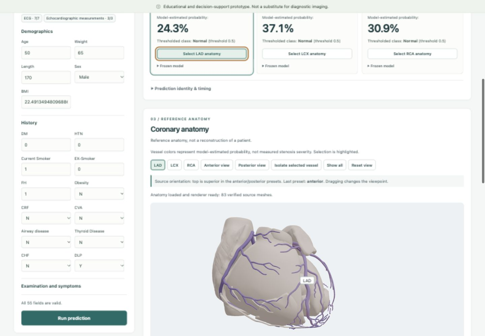
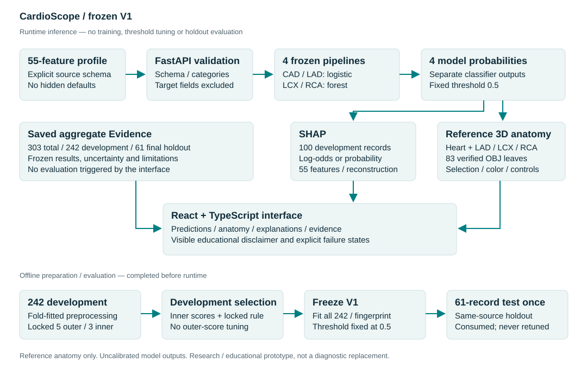

# CardioScope

**Coronary models, made visible.** A Track A educational prototype connecting four frozen classifiers, real 3D reference anatomy, model explanations, and transparent evidence.

**55 predictors · 4 separately trained outputs · 83 verified anatomy meshes · 61-record prespecified same-source holdout**

| Frozen V1 target | ROC-AUC | Recall at 0.5 |
|---|---:|---:|
| CAD | 0.913 | 0.907 |
| LAD | 0.847 | 0.848 |
| LCX | 0.672 | 0.208 |
| RCA | 0.698 | 0.286 |

Models were frozen before the holdout was evaluated once. CAD/LAD performed better; **LCX/RCA missed many positives**. These small same-source results do not establish external clinical validation. [Six-page report](output/pdf/CardioScope-Track-A-Report.pdf) · [Demo storyboard](docs/submission/DEMO_SCRIPT.md)



*Real application capture. Whole-vessel colors encode model-estimated probabilities, not lesion locations or measured narrowing.*

## The problem

A clinical feature table and four probability scores are difficult to interpret spatially. CardioScope lets a user inspect an output, select its named artery, see the factors associated with the model response, and review the evidence supporting that model in one workflow.

## What it does

Enter a complete **55-feature structured profile**, or load the explicitly labeled public development example. Four separately trained classifiers predict **overall CAD**, **LAD stenosis**, **LCX stenosis**, and **RCA stenosis**. CAD has its own model; these outputs do **not** form a joint probability distribution.

- Validated inputs with exact source categories; no hidden defaults, inferred units, or imputation.
- Four frozen pipelines, model-estimated probabilities and fixed **0.5** threshold classes.
- Interactive BodyParts3D heart and coronary groups: selection, rotation, zoom, isolation and view presets.
- Positive-class SHAP explanations linked to entered values and all 55 source features.
- Saved Evidence dashboard with final metrics, confusion matrices, uncertainty and limitations.
- Integrity-checked artifacts, locked environments, Docker and reproducible verification.

> **Educational and decision-support prototype. Not a substitute for diagnostic imaging.** No external clinical validation, calibrated clinical risk, patient-specific geometry, or treatment recommendation is claimed.

## Architecture and workflow



React/TypeScript validates the profile; FastAPI enforces the source schema; four saved scikit-learn pipelines return outputs with model/profile fingerprints. Named vessel probabilities drive the Three.js viewer, and target-specific SHAP explains the same output. Evidence reads saved aggregate results. **There is no live training.**

## Predictive performance: frozen V1 only

**Once-only final evaluation on the prespecified 61-record same-source holdout**, after freezing the models. This provides same-source final-test evidence; **external clinical validation is absent**. All targets use the same records and threshold 0.5.

| Target | Accuracy | Balanced accuracy | Precision | Recall | F1 | ROC-AUC |
|---|---:|---:|---:|---:|---:|---:|
| CAD | 0.8525 | 0.8146 | 0.8864 | 0.9070 | 0.8966 | 0.9134 |
| LAD | 0.7213 | 0.7100 | 0.7000 | 0.8485 | 0.7671 | 0.8474 |
| LCX | 0.6066 | 0.5366 | 0.5000 | 0.2083 | 0.2941 | 0.6723 |
| RCA | 0.6721 | 0.5804 | 0.5455 | 0.2857 | 0.3750 | 0.6976 |

CAD and LAD performed substantially better. LCX/RCA retained moderate ranking ability, but missed many positives at the fixed threshold: recall was **0.2083 / 0.2857**. We report those weaknesses alongside the stronger results. See [all metrics, matrices and uncertainty](docs/FINAL_EVALUATION.md) and the [six-page report](output/pdf/CardioScope-Track-A-Report.pdf).

## Interactive reference anatomy

**83 verified BodyParts3D mesh leaves:** heart base 30, LAD 18, LCX 6, RCA 29. All groups retain one shared coordinate system and one assembly transform; coronary meshes are excluded from the heart base to prevent duplication. Clicking a mesh selects its card; card/control selection highlights the same group. Orbit, zoom, reset, anterior/posterior presets, isolation and show-all are available.

This is **reference anatomy**, not a patient reconstruction, lesion localization, vessel-diameter estimate or simulated stenosis geometry. Colors represent whole-vessel model output magnitude. [Anatomy verification](docs/anatomy/VERIFICATION.md).

## Explainability

CAD/LAD use **Linear SHAP in positive-class log-odds**; LCX/RCA use **TreeSHAP in positive-class probability contribution space**. A deterministic **100-record development-only** reference is fixed. Encoded category contributions aggregate to the original 55 variables; accepted explanations must reconstruct the corresponding unrounded model output within locked tolerances.

Positive and negative contributions explain **model behavior**, not causality or a clinical mechanism. SHAP failure preserves numerical predictions; WebGL failure shows an explicit numerical fallback. [Explanation methods and verification](docs/EXPLANATIONS.md).

## Evaluation methodology

The 303-record public dataset was locked into **242 development / 61 holdout** records before fitting. `Cath`, `LAD`, `LCX`, and `RCA` never enter the 55 predictors. Development uses **5 outer / 3 inner nested folds** with train-only preprocessing and model selection; vocabularies and scalers are fitted inside folds. The 242/61 development-holdout split is shared across targets; each target uses its own locked nested-CV folds. Duplicate-group boundaries are enforced, although true patient IDs are unavailable.

Frozen models: CAD/LAD balanced L2 logistic regression, C=0.1; LCX/RCA unweighted 100-tree forests with maximum depths 3/5 and minimum leaf size 10. The final development-only selection rule uses the existing inner scores, never outer validation results. Models then fit all 242 development records and were frozen before the once-only holdout. [Modeling](docs/MODELING.md).

## What we learned after final evaluation

The consumed holdout exposed weak LCX/RCA sensitivity. We kept V1 frozen and ran two **separate preregistered development-only** studies, using repeated nested CV on the original 242 records.

- **V2:** threshold selection, elastic-net, forest/cost-sensitive variants and XGBoost recovered much of the missed sensitivity, but failed the locked joint stability gate. The **unweighted outer-fold means** across 25 folds per vessel for LCX/RCA sensitivity were about .625/.640, specificity .701/.686, balanced accuracy .663/.663 and ROC-AUC .728/.728. Ranking gains were small or inconsistent. [V2 report](docs/V2_LCX_RCA.md).
- **V2.1:** a small four-task shared neural model had **unweighted outer-fold means** of LCX sensitivity .6075, specificity .6592, balanced accuracy .6333 and ROC-AUC .7015; RCA .6746, .6762, .6754 and .7440. LCX values cover 24 eligible folds; RCA covers 25. RCA passed its internal vessel gate, but LCX and CAD preservation failed. The joint gate failed and **no final all-development neural candidate was fitted**. [V2.1 report](docs/V21_MULTITASK.md).

Both are **post-holdout, development-only research**, without independent validation or deployment. Their results are **internal development research**, not test results or production improvements. V1 remains the product.

## Limitations

Only 303 source records; a small same-source holdout; no independent external cohort or verified true patient IDs; uncalibrated probabilities; weak LCX/RCA sensitivity; and reference anatomy without lesion localization. SHAP associations are not causal. This prototype has no clinical deployment validation and is intended for local educational/research use.

## Install and run

Prerequisites: **Python 3.12.14 exactly**, uv 0.12.1, Node 22.13+ in the 22.x line or Node 24+, npm, and make. If the exact interpreter is installed outside PATH, pass `UV_PYTHON=/path/to/python3.12` to `make install`; see the Ubuntu source-build instructions below. Installation requires network access; a fully installed/built app with bundled artifacts runs locally without external APIs.

```sh
make install prepare verify build
make run
```

Open `http://127.0.0.1:8000`. `make run PORT=8005` uses another loopback port. `prepare` verifies shipped frozen sources; it does not train or regenerate the split. See [exact Ubuntu Python setup and Docker](docs/REPRODUCIBILITY.md).

```sh
docker build -t cardioscope:v1 .
docker run --rm --read-only --tmpfs /tmp --cap-drop ALL --security-opt no-new-privileges \
  -p 127.0.0.1:8000:8000 cardioscope:v1
```

## Reproducibility, testing and CI

The hardened V1 passed **134 Python tests and 75 frontend tests** on macOS ARM64 and clean Ubuntu ARM64, with locked runtime checks, frozen-output/SHAP reconstruction, browser checks and **256 protected-file hashes**. Initial uncompressed JS decreased by about **78%** through lazy loading; total viewer assets were not similarly reduced. Desktop Chromium, Firefox and Safari workflows were verified; no physical-device or Linux graphical-browser certification is claimed.

**GitHub Actions workflow prepared and locally verified. Hosted CI has not run: GitHub rejected the initial push because the current OAuth token lacks `workflow` scope.** [Hardening evidence](docs/HARDENING.md), [CI configuration](.github/workflows/ci.yml), [submission claim audit](docs/submission/CLAIM_AUDIT.md).

Safe documentation-phase checks:

```sh
make lint verify build
.venv/bin/python -m pytest -q tests/test_data.py tests/test_splits.py tests/test_anatomy.py tests/test_actual_sources.py tests/test_api.py
cd frontend && npm test
```

This is the recorded safe submission-phase command: 43 Python tests using `test_api.py` and 75 frontend tests. These do not retrain V1 or repeat the final evaluation. Historical full-suite evidence is distinct from current documentation-phase checks. [Latest polish verification](docs/submission/POLISH_VERIFICATION.json).

## Project structure

```text
backend/               FastAPI, frozen inference, explanations, saved evidence
frontend/              React + TypeScript + Vite; interactive anatomy/dashboard
ml/                    frozen data, modeling, anatomy and evaluation implementation
config/                schema, split, model, evaluation and SHAP contracts
artifacts/             frozen V1 evidence/models; separate research namespaces
assets/anatomy/        verified mappings, licenses and 83 OBJ meshes
docs/                  detailed methodology and engineering evidence
docs/submission/       report source, demo, Devpost copy, Q&A and checklists
output/pdf/            final six-page Track A report
research/              V2/V2.1 only; never imported into product inference
```

## Provenance, license and attribution

Dataset: [UCI Extension of Z-Alizadeh Sani, DOI 10.24432/C5461K](https://doi.org/10.24432/C5461K), **CC BY 4.0**. Anatomy: **BodyParts3D, © The Database Center for Life Science licensed under CC Attribution 4.0 International**, obtained from the [current archive](https://dbarchive.biosciencedbc.jp/en/bodyparts3d/lic.html). Source meshes are unchanged; documented adaptations are grouping/subtraction and a shared display transform. [Source notes](docs/SOURCE_NOTES.md), [third-party notices](THIRD_PARTY_NOTICES.md).

**Project-authored code is licensed under [MIT](LICENSE)**, Copyright (c) 2026 CardioScope contributors. UCI data and BodyParts3D anatomy retain **CC BY 4.0**; dependency licenses and notices remain separate. MIT does not cover organizer-owned documents. The public export omits all seven organizer PDFs; the original archival repository/history remains preserved. [Publication record](docs/submission/PUBLICATION.md).

## Report and demo materials

- [Six-page Track A PDF](output/pdf/CardioScope-Track-A-Report.pdf) and [editable generation source](docs/submission/report_source.py).
- [Five-minute demo storyboard](docs/submission/DEMO_SCRIPT.md) and [deterministic rehearsal checklist](docs/submission/DEMO_REHEARSAL.md).
- [Devpost-ready copy](docs/submission/DEVPOST.md), [judge Q&A](docs/submission/JUDGE_QA.md), [submission checklist](docs/submission/SUBMISSION_CHECKLIST.md).
- YouTube demo and Devpost URLs: **not yet provided**. The user will record/upload the demo and complete Devpost separately; no video or submission link is invented.

Public GitHub repository: [AbhikRao/CardioScope](https://github.com/AbhikRao/CardioScope). The repository is public but its initial code push is blocked by missing OAuth `workflow` scope. See [publication status and resume commands](docs/submission/PUBLICATION_RESULT.json).
