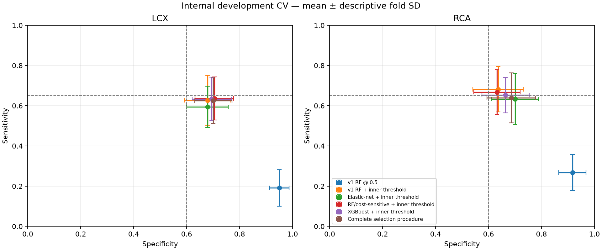

# CardioScope v2 LCX/RCA — one bounded development experiment

This experiment was motivated **after** the v1 final holdout had been observed. The old 61 records are a consumed historical v1 test — not v2 validation. No reserved outcome was decoded or used in this experiment. V1 remains the only version with the existing independent final-holdout result.

V2 evidence is **internally validated using repeated nested cross-validation** on the original 242 development records. It is not independent or external validation. No v2 candidate is deployed; the v1 product, threshold, evidence, SHAP and anatomy remain unchanged.

## Frozen provenance and preregistration

Experiment: `v2-lcx-rca-20261003-01`. Starting hardened commit: `1a0ed0eaf8f672b9f214a33a435bc2968e19a21e`. V1 tag: `cardioscope-v1.0.0` at `c75913853577e802703b7509334963d9be1fd868`.

Protocol SHA-256: `9c0358077d457273ae01c9d92fdbb05da109843bb1ce00fcde493479fb679116`. Schema: `b94a1e93d98728e465d42f578f7e66008d04618b04f5db4076fa997e691a9d01`. Development membership: `e56cf3bf38426d1aac24cd9b6c3ec179a28bf481c2d7b214f90bcf891ad34a4e`.

[Protocol](../research/v2_lcx_rca/protocol.json), [hash receipt](../research/v2_lcx_rca/protocol.sha256), [experimental folds](../research/v2_lcx_rca/folds.json), [experimental dependency lock](../research/v2_lcx_rca/requirements.lock.txt). Protocol, folds, runtime and implementation hashes were sealed before real-data fitting. Search space/seeds/gates were not adapted after results.

## Method

Each target has five deterministic repetitions of target-stratified 5-fold outer CV (25 evaluations), with stratified 4-fold inner cross-fitting confined to each outer-training set. Duplicate predictor-group boundaries are enforced at both levels; this source has no duplicated development groups and no authoritative patient IDs. Outer seeds: `[1729, 2718, 3141, 5772, 8119]`; all inner/final/estimator seeds are in the protocol.

All 55 exact predictors are retained, in locked order. Cath/LAD/LCX/RCA, aliases and derived fields are rejected. One-hot vocabulary is learned within each fit, never from validation rows. Elastic-net numeric scaling is fold-fitted; tree numerics pass through. No imputation, feature selection, calibration, early stopping or validation-derived class weights.

The reference exactly refits the v1 RF specification (100 trees, seed 42, bootstrap, sqrt feature sampling, leaf 10; LCX depth 3 / RCA depth 5) on the new outer-training sets. It does not load a model already fitted on all 242 records to score those records.

Alternatives: 18 elastic-net configurations (C=.03/.1/.3, l1_ratio=0/.5/.9, unweighted/balanced; SAGA, 20,000 iterations, tol=1e-7, non-convergence aborts); 8 forests (depth 3/5, leaf 5/10, unweighted/balanced, 500 seeded single-threaded trees); 6 XGBoost configurations (depth 1/2/3 with unweighted or training-fold negative/positive weighting). XGBoost fixes 200 trees, learning rate .03, child weight 5, row/column sampling .8, L2=10, gamma=1, CPU hist, one thread. [XGBoost parameter definitions](https://xgboost.readthedocs.io/en/stable/parameter.html) and [scikit-learn logistic solver definitions](https://scikit-learn.org/stable/modules/generated/sklearn.linear_model.LogisticRegression.html) support these implementations. There is no second boosting library.

For each candidate, choose the **highest** inner OOF threshold satisfying sensitivity≥.65 and specificity≥.60; predict positive when probability≥threshold. No feasible threshold means ineligible, without an alternative objective or fallback. Rank eligible candidates by inner balanced accuracy, trapezoidal PR-AUC, ROC-AUC, then locked simplicity rank (12-decimal ties). The complete pool contains the target's unchanged reference plus all 32 alternatives. Every arm's rule is frozen before outer outcomes are retrieved; identical selected fits are reused.

The complete selection procedure is primary. Family-specific procedures are diagnostic, not grounds to replace it with a retrospectively better outer family. Full-development candidates use the same selection rule in a separately predeclared 4-fold inner split of all 242 records.

## Locked success gate

For each target: all 25 primary rules eligible; mean sensitivity≥.65, specificity≥.60 and balanced accuracy≥.625; at least 4/5 repeat-pooled results meet all three; no repeat sensitivity<.55 or specificity<.50. Mean ROC-AUC may not fall more than .02 below the same-fold reference. Mean precision, PR-AUC and AP must each exceed prevalence by .05; mean predicted-positive rate≤.65. These repeatability/quality definitions operationalize the request before fitting. BOTH targets must pass for joint success. They are prototype research criteria, not clinical standards.

## Complete development results

Values below are unweighted outer-fold mean ± sample SD. Missing operating rules are not substituted; available-fold diagnostic summaries are explicitly counted and incomplete repeats receive no pooled operating estimate. All median/min/max/individual metric values and confusion matrices are in [results.json](../artifacts/experiments/v2-lcx-rca-20261003-01/results.json), [all outer evaluations CSV](../artifacts/experiments/v2-lcx-rca-20261003-01/outer_metrics.csv), and per-fold JSON in the same artifact directory. No unfavorable metric is omitted.

### LCX

| Arm | Evaluated /25 | Sensitivity | Specificity | BA | PPV | F1 | ROC-AUC | PR-AUC | AP | Positive rate | Prevalence |
| --- | ---: | ---: | ---: | ---: | ---: | ---: | ---: | ---: | ---: | ---: | ---: |
| v1 RF @ 0.5 | 25 | 0.192 ± 0.091 | 0.950 ± 0.038 | 0.571 ± 0.045 | 0.726 ± 0.188 | 0.293 ± 0.119 | 0.723 ± 0.053 | 0.614 ± 0.072 | 0.633 ± 0.066 | 0.106 ± 0.047 | 0.393 ± 0.004 |
| v1 RF + inner threshold | 23 | 0.627 ± 0.124 | 0.679 ± 0.087 | 0.653 ± 0.060 | 0.561 ± 0.061 | 0.587 ± 0.076 | 0.719 ± 0.053 | 0.607 ± 0.072 | 0.626 ± 0.066 | 0.441 ± 0.085 | 0.393 ± 0.004 |
| Elastic-net + inner threshold | 24 | 0.594 ± 0.102 | 0.679 ± 0.079 | 0.637 ± 0.059 | 0.547 ± 0.067 | 0.566 ± 0.074 | 0.714 ± 0.062 | 0.603 ± 0.090 | 0.621 ± 0.085 | 0.428 ± 0.068 | 0.392 ± 0.004 |
| RF/cost-sensitive + inner threshold | 25 | 0.636 ± 0.107 | 0.705 ± 0.073 | 0.670 ± 0.052 | 0.585 ± 0.057 | 0.605 ± 0.068 | 0.736 ± 0.050 | 0.616 ± 0.076 | 0.637 ± 0.069 | 0.429 ± 0.072 | 0.393 ± 0.004 |
| XGBoost + inner threshold | 23 | 0.634 ± 0.108 | 0.695 ± 0.074 | 0.664 ± 0.058 | 0.576 ± 0.063 | 0.600 ± 0.072 | 0.732 ± 0.048 | 0.621 ± 0.065 | 0.639 ± 0.060 | 0.434 ± 0.068 | 0.393 ± 0.004 |
| Complete selection procedure | 25 | 0.625 ± 0.113 | 0.701 ± 0.070 | 0.663 ± 0.059 | 0.577 ± 0.064 | 0.596 ± 0.074 | 0.728 ± 0.047 | 0.616 ± 0.069 | 0.634 ± 0.064 | 0.427 ± 0.068 | 0.393 ± 0.004 |

#### Threshold distributions and selections

| Arm | Eligible thresholds | Median | Min | Max | Selected families |
| --- | ---: | ---: | ---: | ---: | --- |
| v1 RF @ 0.5 | 25 | 0.500000 | 0.500000 | 0.500000 | `{'reference': 25}` |
| v1 RF + inner threshold | 23 | 0.408526 | 0.399869 | 0.422285 | `{'reference': 23}` |
| Elastic-net + inner threshold | 24 | 0.425336 | 0.381622 | 0.546049 | `{'elastic_net': 24}` |
| RF/cost-sensitive + inner threshold | 25 | 0.495997 | 0.393555 | 0.519236 | `{'forest': 25}` |
| XGBoost + inner threshold | 23 | 0.447833 | 0.378895 | 0.532877 | `{'xgboost': 23}` |
| Complete selection procedure | 25 | 0.447833 | 0.381622 | 0.546049 | `{'elastic_net': 6, 'xgboost': 6, 'forest': 9, 'reference': 4}` |

#### Repeat-to-repeat stability

Primary procedure: one cross-fitted prediction per patient per repeat.

| Repeat | Status | Sensitivity | Specificity | BA | PPV | ROC-AUC | PR-AUC | AP | Positive rate | Confusion [TN FP; FN TP] |
| --- | --- | ---: | ---: | ---: | ---: | ---: | ---: | ---: | ---: | --- |
| 1 | evaluated | 0.611 | 0.673 | 0.642 | 0.547 | 0.694 | 0.584 | 0.588 | 0.438 | `[[99, 48], [37, 58]]` |
| 2 | evaluated | 0.653 | 0.741 | 0.697 | 0.620 | 0.720 | 0.618 | 0.621 | 0.413 | `[[109, 38], [33, 62]]` |
| 3 | evaluated | 0.642 | 0.687 | 0.665 | 0.570 | 0.720 | 0.580 | 0.586 | 0.442 | `[[101, 46], [34, 61]]` |
| 4 | evaluated | 0.611 | 0.701 | 0.656 | 0.569 | 0.706 | 0.556 | 0.562 | 0.421 | `[[103, 44], [37, 58]]` |
| 5 | evaluated | 0.611 | 0.701 | 0.656 | 0.569 | 0.704 | 0.560 | 0.566 | 0.421 | `[[103, 44], [37, 58]]` |

**Primary gate: FAIL.** Checks: `{'ap_above_prevalence': True, 'mean_screening_metrics': False, 'no_extreme_repeat': True, 'no_material_auc_collapse': True, 'not_nearly_everyone_positive': True, 'pr_auc_above_prevalence': True, 'precision_above_prevalence': True, 'repeat_stability': False}`. Threshold-only gate: `{'checks': {}, 'passed': False, 'reason': 'Not all 25 outer rules were eligible'}`.

**Diagnosis:** C: complete procedure fails the locked development gate; retain v1 and stop searching.

#### Full-development candidate (not deployed)

Selected `xgb-d3-none`; parameters `{'max_depth': 3}`; threshold **0.42826700210571289**. Exact fixed parameters are in the protocol and the pipeline joblib. Fitted on `242` development records only. Single-profile latency median of 20: 3.935 ms.

The final candidate's inner selection scores are not its independent performance. A persisted research candidate can exist even when the nested development gate fails; persistence is not promotion or a success claim.

The following intervals target the **mean of the five repeat-pooled metrics**, not the unweighted 25-fold mean in the comparison table. Pooling mixes uncalibrated scores from fold-specific models and class-weighting choices, so pooled ROC-AUC/PR-AUC/AP can differ from mean within-fold ranking metrics. No calibration or score harmonization was added.

Conditional patient/group bootstrap 95% percentile intervals for the complete procedure: `{'percentile_95': {'average_precision': [0.49921993297242406, 0.6801710434702661], 'balanced_accuracy': [0.6142881097560975, 0.7149978717902254], 'pr_auc': [0.4891790177104063, 0.6723005709938937], 'precision': [0.4911514678281374, 0.6580011186184264], 'predicted_positive_rate': [0.37190082644628103, 0.48429752066115694], 'roc_auc': [0.6531700711121626, 0.7670408447006657], 'sensitivity': [0.5460657303370787, 0.7051546391752577], 'specificity': [0.6383512076423936, 0.7647172675521821]}, 'samples': 2000, 'status': 'conditional patient/group bootstrap, not independent validation'}`.

### RCA

| Arm | Evaluated /25 | Sensitivity | Specificity | BA | PPV | F1 | ROC-AUC | PR-AUC | AP | Positive rate | Prevalence |
| --- | ---: | ---: | ---: | ---: | ---: | ---: | ---: | ---: | ---: | ---: | ---: |
| v1 RF @ 0.5 | 25 | 0.267 ± 0.090 | 0.917 ± 0.051 | 0.592 ± 0.047 | 0.684 ± 0.145 | 0.376 ± 0.105 | 0.718 ± 0.068 | 0.621 ± 0.074 | 0.636 ± 0.071 | 0.154 ± 0.052 | 0.384 ± 0.008 |
| v1 RF + inner threshold | 21 | 0.682 ± 0.113 | 0.636 ± 0.096 | 0.659 ± 0.067 | 0.542 ± 0.073 | 0.600 ± 0.075 | 0.717 ± 0.072 | 0.619 ± 0.080 | 0.635 ± 0.076 | 0.486 ± 0.079 | 0.383 ± 0.008 |
| Elastic-net + inner threshold | 25 | 0.634 ± 0.127 | 0.701 ± 0.089 | 0.667 ± 0.074 | 0.574 ± 0.088 | 0.597 ± 0.091 | 0.733 ± 0.070 | 0.626 ± 0.104 | 0.641 ± 0.097 | 0.428 ± 0.078 | 0.384 ± 0.008 |
| RF/cost-sensitive + inner threshold | 25 | 0.668 ± 0.112 | 0.632 ± 0.088 | 0.650 ± 0.070 | 0.534 ± 0.078 | 0.591 ± 0.083 | 0.723 ± 0.074 | 0.629 ± 0.102 | 0.643 ± 0.095 | 0.484 ± 0.070 | 0.384 ± 0.008 |
| XGBoost + inner threshold | 22 | 0.653 ± 0.088 | 0.664 ± 0.089 | 0.658 ± 0.067 | 0.553 ± 0.078 | 0.596 ± 0.073 | 0.717 ± 0.069 | 0.597 ± 0.081 | 0.614 ± 0.077 | 0.458 ± 0.061 | 0.384 ± 0.009 |
| Complete selection procedure | 25 | 0.640 ± 0.125 | 0.686 ± 0.092 | 0.663 ± 0.070 | 0.565 ± 0.085 | 0.595 ± 0.087 | 0.728 ± 0.076 | 0.618 ± 0.112 | 0.634 ± 0.104 | 0.439 ± 0.081 | 0.384 ± 0.008 |

#### Threshold distributions and selections

| Arm | Eligible thresholds | Median | Min | Max | Selected families |
| --- | ---: | ---: | ---: | ---: | --- |
| v1 RF @ 0.5 | 25 | 0.500000 | 0.500000 | 0.500000 | `{'reference': 25}` |
| v1 RF + inner threshold | 21 | 0.391965 | 0.383307 | 0.414900 | `{'reference': 21}` |
| Elastic-net + inner threshold | 25 | 0.488023 | 0.354967 | 0.545227 | `{'elastic_net': 25}` |
| RF/cost-sensitive + inner threshold | 25 | 0.491933 | 0.382617 | 0.508639 | `{'forest': 25}` |
| XGBoost + inner threshold | 22 | 0.440146 | 0.361286 | 0.511120 | `{'xgboost': 22}` |
| Complete selection procedure | 25 | 0.495123 | 0.354967 | 0.545227 | `{'xgboost': 4, 'forest': 4, 'elastic_net': 17}` |

#### Repeat-to-repeat stability

Primary procedure: one cross-fitted prediction per patient per repeat.

| Repeat | Status | Sensitivity | Specificity | BA | PPV | ROC-AUC | PR-AUC | AP | Positive rate | Confusion [TN FP; FN TP] |
| --- | --- | ---: | ---: | ---: | ---: | ---: | ---: | ---: | ---: | --- |
| 1 | evaluated | 0.688 | 0.671 | 0.680 | 0.566 | 0.744 | 0.588 | 0.596 | 0.467 | `[[100, 49], [29, 64]]` |
| 2 | evaluated | 0.656 | 0.691 | 0.674 | 0.570 | 0.723 | 0.624 | 0.627 | 0.442 | `[[103, 46], [32, 61]]` |
| 3 | evaluated | 0.570 | 0.678 | 0.624 | 0.525 | 0.708 | 0.604 | 0.608 | 0.417 | `[[101, 48], [40, 53]]` |
| 4 | evaluated | 0.667 | 0.691 | 0.679 | 0.574 | 0.695 | 0.568 | 0.574 | 0.446 | `[[103, 46], [31, 62]]` |
| 5 | evaluated | 0.624 | 0.698 | 0.661 | 0.563 | 0.681 | 0.523 | 0.532 | 0.426 | `[[104, 45], [35, 58]]` |

**Primary gate: FAIL.** Checks: `{'ap_above_prevalence': True, 'mean_screening_metrics': False, 'no_extreme_repeat': True, 'no_material_auc_collapse': True, 'not_nearly_everyone_positive': True, 'pr_auc_above_prevalence': True, 'precision_above_prevalence': True, 'repeat_stability': False}`. Threshold-only gate: `{'checks': {}, 'passed': False, 'reason': 'Not all 25 outer rules were eligible'}`.

**Diagnosis:** C: complete procedure fails the locked development gate; retain v1 and stop searching.

#### Full-development candidate (not deployed)

Selected `elastic-C0.1-l10.9-None`; parameters `{'C': 0.1, 'class_weight': None, 'l1_ratio': 0.9}`; threshold **0.41636245476247941**. Exact fixed parameters are in the protocol and the pipeline joblib. Fitted on `242` development records only. Single-profile latency median of 20: 4.007 ms.

The final candidate's inner selection scores are not its independent performance. A persisted research candidate can exist even when the nested development gate fails; persistence is not promotion or a success claim.

The following intervals target the **mean of the five repeat-pooled metrics**, not the unweighted 25-fold mean in the comparison table. Pooling mixes uncalibrated scores from fold-specific models and class-weighting choices, so pooled ROC-AUC/PR-AUC/AP can differ from mean within-fold ranking metrics. No calibration or score harmonization was added.

Conditional patient/group bootstrap 95% percentile intervals for the complete procedure: `{'percentile_95': {'average_precision': [0.5004387324335228, 0.6865835759112539], 'balanced_accuracy': [0.6084694541263133, 0.7164203702443713], 'pr_auc': [0.49004345666078447, 0.6790378212854056], 'precision': [0.4686989943608636, 0.6465152278419308], 'predicted_positive_rate': [0.3851033057851239, 0.49421487603305786], 'roc_auc': [0.6491740410692624, 0.7670331550494593], 'sensitivity': [0.5536656346749226, 0.7261910540915396], 'specificity': [0.6215883274578926, 0.7503526914121351]}, 'samples': 2000, 'status': 'conditional patient/group bootstrap, not independent validation'}`.

## Joint conclusion

Locked joint success: **FAIL**. The two targets are separate problems; a favorable result for one does not rescue a failed joint gate. No new search, threshold objective, calibration or feature subset is authorized by these results.



Plot error bars are descriptive sample SD across correlated folds, not independent-cohort confidence intervals or a fitted ROC frontier. Ineligible arms use only the explicitly counted available folds (23/24 for some LCX arms, 21/22 for some RCA arms); the primary procedure and reference each cover all 25.

## Paired comparisons and interpretation

Each arm below is paired with v1 RF @ 0.5 on **exactly its own eligible outer folds**. Ineligible folds remain failures, not imputations. These descriptive differences do not change the primary procedure, candidates or protocol. They are not tests across independent cohorts. Full metric-by-metric pairs are in [paired_comparisons.json](../artifacts/experiments/v2-lcx-rca-20261003-01/paired_comparisons.json) and [CSV](../artifacts/experiments/v2-lcx-rca-20261003-01/paired_comparisons.csv).

| Target | Arm | Paired folds | Δ Sensitivity | Δ Specificity | Δ BA | Δ ROC-AUC | Δ PR-AUC | Δ AP | Δ PPV |
| --- | --- | ---: | ---: | ---: | ---: | ---: | ---: | ---: | ---: |
| LCX | elastic_net | 24 | +0.4079 | -0.2704 | +0.0687 | -0.0068 | -0.0064 | -0.0085 | -0.1730 |
| LCX | forest | 25 | +0.4442 | -0.2451 | +0.0996 | +0.0133 | +0.0026 | +0.0045 | -0.1410 |
| LCX | selection_procedure | 25 | +0.4337 | -0.2488 | +0.0924 | +0.0054 | +0.0022 | +0.0011 | -0.1489 |
| LCX | v1_rf_nested_threshold | 23 | +0.4371 | -0.2706 | +0.0833 | +0.0000 | +0.0000 | +0.0000 | -0.1688 |
| LCX | xgboost | 23 | +0.4439 | -0.2576 | +0.0932 | +0.0139 | +0.0096 | +0.0091 | -0.1618 |
| RCA | elastic_net | 25 | +0.3662 | -0.2162 | +0.0750 | +0.0153 | +0.0047 | +0.0049 | -0.1101 |
| RCA | forest | 25 | +0.4007 | -0.2847 | +0.0580 | +0.0045 | +0.0076 | +0.0074 | -0.1500 |
| RCA | selection_procedure | 25 | +0.3724 | -0.2309 | +0.0707 | +0.0097 | -0.0025 | -0.0018 | -0.1188 |
| RCA | v1_rf_nested_threshold | 21 | +0.4089 | -0.2792 | +0.0649 | +0.0000 | +0.0000 | +0.0000 | -0.1444 |
| RCA | xgboost | 22 | +0.3922 | -0.2489 | +0.0717 | +0.0040 | -0.0148 | -0.0130 | -0.1178 |

**Operating point:** changing the RF threshold increases mean sensitivity by about 44 percentage points for LCX and 42 for RCA on matched eligible folds, while losing about 26 and 28 specificity points. It does not improve ranking: paired ROC-AUC, PR-AUC and AP differences are exactly zero. The threshold-only arms nevertheless fail feasibility in 2/25 LCX and 4/25 RCA outer-training partitions; their available-fold means do not establish a complete passing procedure.

**Fitting/model family:** alternatives produce only small, inconsistent ranking gains. The complete procedure gains approximately .005 LCX and .010 RCA mean ROC-AUC over the same-fold reference; its sensitivity remains below .65 and its repeat stability fails. Weighting is nested, but these selected-family diagnostics do not isolate a causal benefit from weighting versus structural/regularization settings. No consistent advantage sufficient to promote the boosting challenger is established.

**Repeat stability:** LCX meets all three absolute operating criteria in only **1/5** pooled repetitions; RCA in **3/5**, below the locked 4/5 requirement. LCX primary sensitivity spans .611–.653; RCA .570–.688. Better RCA forest-family mean recall (.668) does not authorize replacing the complete procedure after viewing outer results.

**Recommendation:** Case C under the locked gate. Much of the sensitivity deficit is an operating-point effect, but thresholding alone is not a sufficiently stable complete solution, and the bounded alternatives do not establish a passing replacement. Keep v1 unchanged; preserve both full-development candidates for research only. Stop this search. Any independent v2 validation would require genuinely new untouched data.

The [post-run evidence audit](../artifacts/experiments/v2-lcx-rca-20261003-01/audit.json) checks every fitting membership, all inner thresholds and selections, all scored outer metrics, exact final 242-record memberships and paired reference comparisons. It performs no fitting and changes no registered rule.

## Runtime and reproduction

Total experiment wall time: **582.48 seconds**; **7060 fits**. Reused identical reference/selected predictions are counted once. Per-family fit counts/seconds (excludes preprocessing/selection/report overhead outside fitting):

```json
{
  "elastic_net": {
    "fit_count": 3794,
    "fit_seconds": 161.29478420183295
  },
  "forest": {
    "fit_count": 1714,
    "fit_seconds": 305.4803076783719
  },
  "reference": {
    "fit_count": 258,
    "fit_seconds": 10.84003962110728
  },
  "xgboost": {
    "fit_count": 1294,
    "fit_seconds": 22.487952781986678
  }
}
```

The **complete second run passed**, repeating all 7,060 fits in **583.66 seconds**. Choices, thresholds, all metrics, inner/outer OOF probabilities and saved/fresh final-model probabilities matched (atol=1e-12, rtol=1e-10). See [reproduction.json](../artifacts/experiments/v2-lcx-rca-20261003-01/reproduction.json).

Use the separate environment; do not install XGBoost into v1:

```sh
uv venv --python .venv/bin/python .runtime/v2
uv pip sync --python .runtime/v2/bin/python research/v2_lcx_rca/requirements.lock.txt
.runtime/v2/bin/python -m pytest research/v2_lcx_rca/tests -q
.runtime/v2/bin/python -m research.v2_lcx_rca.run --reproduce
```

`--reproduce` repeats every inner/outer fit and full-development selection without overwriting models/results, comparing choices, thresholds, all metrics/OOF probabilities and saved/fresh candidate probabilities within the locked tolerances. Protocol/runtime/code/inputs and saved artifact hashes are checked first. Timing is separately recorded. Registration cannot be repeated to redefine this experiment. The documented experimental lock is tested on macOS ARM64; v2 Linux portability is not claimed.

## Boundary and verification

Runtime guards forbid the reserved loader, final evaluator, full-workbook outcome audit/loading and split recreation. The existing safe development reader hashes predictor groups before decoding development targets; reserved target cells are skipped. Opaque source/protected bytes and original split IDs are read for integrity/membership, not interpreted as v2 outcomes. Synthetic poisoned-target tests fail loudly if reserved cells are decoded. All training memberships are checked and recorded; outer outcomes enter only scoring after rules are fixed.

[Verification record](../artifacts/experiments/v2-lcx-rca-20261003-01/verification.json) records the safe v1/v2 checks, unchanged protected files and complete deterministic rerun. No frontend, v1 models/locks/evidence/SHAP/anatomy or final-evaluation receipt is modified.

## Final checks

- 29 experimental tests passed without skips.
- 61 safe v1 foundation/modeling Python tests passed; historical-performance-reading application/evidence tests and final-evaluator tests were deliberately excluded.
- All 75 existing frontend tests across 8 files passed.
- V1/v2 Ruff lint/format, TypeScript and frozen source/anatomy checks passed.
- All 256 protected files match both the manifest and actual `cardioscope-v1.0.0` Git bytes; all 53 v1 package versions and original locks are unchanged.
- The post-run audit independently rechecks all 7,060 fitting memberships, thresholds/selections, 288 scored outer arm/fold combinations, exact final development memberships and matched reference comparisons.
- No reserved outcomes, final evaluator, old-holdout model comparison or v2 product deployment was used. Integrity hashing of opaque frozen files is distinguished from outcome access.

## Limitations and evidence status

This is a small, same-source development experiment motivated post-holdout. Repetitions reuse the same patients and overlapping training data; 25 folds are not 25 independent studies. Thresholds are adaptive selection inputs estimated from relatively small inner OOF panels. The bootstrap resamples patient/group predictions jointly across five repeats, conditional on the fitted rules; it omits retraining/selection uncertainty and is not a complete generalization confidence interval. True patient identifiers are unavailable. RF randomness is fixed; 500 trees reduce but do not prove elimination of Monte Carlo variability. Probabilities are uncalibrated; class weighting can change their interpretation. PR-AUC is trapezoidal and distinct from AP. Prototype sensitivity/specificity constraints establish no clinical safety or utility. Any future claim of independent v2 validation requires genuinely new, untouched data.

**Stop here. Keep v1 deployed unchanged. These candidates remain research artifacts only.**
