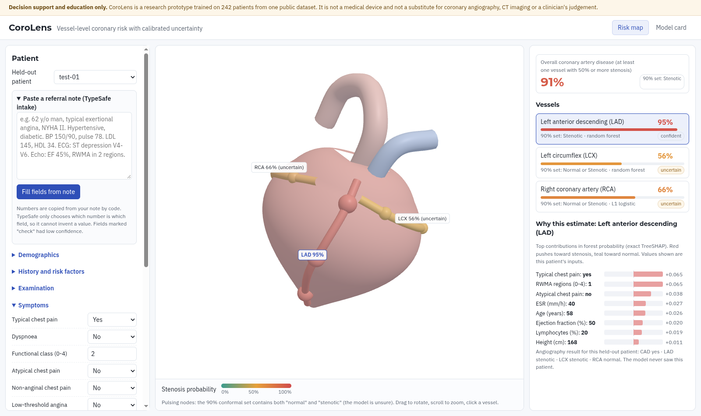

# CoroLens

**Vessel-level coronary stenosis risk on an interactive 3D heart, with calibrated uncertainty and exact explanations. Runs in the browser.**

Multimodal AI Hackathon 2026 (IIT Mandi), **Track A: Cardiovascular Risk Visualization & Prediction**.

> Decision support and education only. CoroLens is a research prototype trained on 242 patients from one public dataset.
> It is not a medical device and not a substitute for coronary angiography, CT imaging or a clinician's judgement.



Project documentation (4 pages): [docs/CoroLens_Report.pdf](docs/CoroLens_Report.pdf) (source: [docs/REPORT.md](docs/REPORT.md)).

## What it does

1. **Predicts** overall CAD and stenosis (50% or more narrowing) of the **LAD, LCX and RCA** from 55 clinical, ECG, lab and echo features
   (UCI "Extension of Z-Alizadeh Sani", 303 patients). LAD, LCX, RCA and Cath are never used as inputs, which prevents target leakage.
2. **Says how sure it is.** Probabilities are Platt-calibrated, and each vessel gets a **90% split-conformal prediction set**.
   If the set is {Normal, Stenotic}, the model is honestly unsure, and that vessel's nodes **pulse** on the 3D heart.
3. **Explains** every prediction with exact SHAP values:
   - **exact TreeSHAP** for random forests, implemented in JavaScript and checked against the `shap` library to 1e-9;
   - exact linear SHAP for logistic models.

   The patient's physiological values are shown next to their contributions.
4. **Maps** the risk onto a schematic 3D heart (Three.js). Each artery and its proximal/mid/distal nodes are coloured by that vessel's
   stenosis probability. You can rotate, zoom and click a vessel to see its explanation. Edits to any input update everything instantly (what-if).
5. **Reads a referral note** (the multimodal step: free text to structured data) with **TypeSafe's Jev model**, using the
   "select instead of generate" pattern:
   - code tags every number in the note;
   - Jev only *chooses* which tagged number is which lab or vital (or none);
   - yes/no findings are answered as calibrated probabilities;
   - categories are picked from closed sets.

   Values are copied by code, so the model cannot invent or mistype a number. Low-confidence fields are flagged "check".

All inference (models, calibration, conformal sets, SHAP) runs **client-side** from a 0.7 MB JSON bundle, so patient data typed into the
risk map never leaves the browser. Only the optional note intake calls a server function, which forwards the note to TypeSafe.

## Results (real, from `results/`)

Held-out test set: 61 patients never used for model selection, calibration or conformal fitting. The threshold is 0.5 on calibrated probability, and 95% CIs come from a 1000-sample bootstrap.

| Target | Model (picked by CV) | ROC-AUC (95% CI) | Accuracy | Precision | Recall | F1 (95% CI) | Brier | 90% set coverage | Nested CV AUC (dev) |
|---|---|---|---|---|---|---|---|---|---|
| Overall CAD | L1 logistic | 0.906 (0.81-0.98) | 0.852 | 0.886 | 0.907 | 0.897 (0.82-0.96) | 0.108 | 90.2% | 0.927 +/- 0.041 |
| LAD | Random forest | 0.910 (0.83-0.98) | 0.852 | 0.846 | 0.917 | 0.880 (0.79-0.95) | 0.119 | 95.1% | 0.811 +/- 0.074 |
| LCX | Random forest | 0.730 (0.60-0.85) | 0.639 | 0.647 | 0.407 | 0.500 (0.30-0.66) | 0.209 | 93.4% | 0.689 +/- 0.088 |
| RCA | L1 logistic | 0.699 (0.56-0.82) | 0.623 | 0.562 | 0.360 | 0.439 (0.24-0.61) | 0.226 | 85.2% | 0.741 +/- 0.041 |

- **Nested CV:** outer 5x2 folds on the 242 development patients. Model choice, calibration and conformal fitting are repeated inside every fold, which gives an unbiased estimate of the whole procedure.
- **CAD consistency:** the overall CAD call agrees with "any vessel predicted stenotic" for 90.2% of held-out patients.
- **LCX and RCA are hard to predict from clinical data alone.** The conformal sets show this: 56% (LCX) and 49% (RCA) of held-out patients get the two-label "uncertain" set, against 13% for overall CAD. The interface shows this uncertainty instead of hiding it.

**TypeSafe note intake** was tested with live `jev-1.13.0` calls on 61 fresh notes built from the held-out patients' real records. The notes use varied phrasing, negations and distractor numbers such as drug doses, dates and follow-up intervals. Seed-11 notes were used only for this final number (`results/intake_eval/`):

| Check | Accuracy |
|---|---|
| Number in the note assigned to the right field | 100.00% (1003 / 1003) |
| Field absent from the note left empty (no invented value) | 100.00% (217 / 217) |
| Yes/no findings | 99.94% (1707 / 1708) |
| Categorical fields (sex, valve disease, BBB, functional class, RWMA regions) | 100.00% (305 / 305) |

- **Downstream effect:** the mean change in predicted probability against hand entry of the same facts is 0.0000 (CAD), 0.0001 (LAD), 0.0001 (LCX) and 0.0031 (RCA).
- **Cost:** about 16.7k input tokens per note.
- **Design history:** version 1 asked chest-pain type and smoking status as separate yes/no questions and reached 98.19% on yes/no findings (development notes, seed 7). Those findings never co-occur in the data, so version 2 asks each as one Choice. This raised yes/no accuracy to 99.94% on both the development notes and the fresh test notes.
- **Caveat:** template notes are easier than real clinical notes.

## Run it

```bash
# web app (Node.js 18+); the risk map works offline, intake needs a TypeSafe key
npm test                                    # 12 JS tests: TreeSHAP parity, sklearn parity, intake logic
TYPESAFE_API_KEY=... node server.mjs        # http://localhost:8787
```

```bash
# retrain and re-evaluate (Python 3.13)
python -m venv .venv && source .venv/bin/activate
pip install -r requirements.txt
python -m pytest -q                         # 7 Python tests
python -m corolens.corolens__corolens__train                    # about 6 min; writes results/metrics.json and web/model/*.json
python scripts/make_eval_notes.py 11        # synthetic notes from held-out records
TYPESAFE_API_KEY=... node scripts/eval_intake.mjs results/intake_eval/notes_test_seed11.json results/intake_eval/v2_test_seed11_summary.json
```

## Architecture

```
data/ (UCI xlsx) -> corolens/corolens__corolens__train.py -> web/model/corolens_model.json (trees, coefficients, Platt, conformal q)
                                       -> results/metrics.json, tests/fixtures/parity.json (sklearn + shap reference values)
browser: web/engine.js (encode, predict, calibrate, conformal, TreeSHAP) -> web/heart.js (Three.js) + web/corolens__web__app.js (dashboard)
note:    web/corolens__web__app.js -> /api/intake (api/intake.js, Vercel function) -> web/intake_core.js -> TypeSafe /v1/systemone
```

- The architecture can grow: adding a feature means adding a column to `corolens/corolens__corolens__data.py`, and adding a target or vessel means adding an entry to `TARGETS` and a path in `web/heart.js`. The engine is model-agnostic for forests and linear models.
- The 3D heart is procedural and schematic, so no third-party mesh licence is needed. The three target arteries follow the anterior interventricular groove (LAD), the left AV groove (LCX) and the right AV groove (RCA). The dataset labels whole vessels, so all nodes of a vessel share its probability; CoroLens does not pretend to localise a lesion within a vessel.

## Limitations

- 303 patients from one Iranian centre (Z-Alizadeh Sani). The model is not validated on other populations, and the held-out CIs are wide.
- RCA and LCX discrimination is modest (AUC about 0.7). Treat these vessel calls as uncertain unless the conformal set is a single label.
- Conformal coverage is guaranteed only on average and under exchangeability, not per patient.
- SHAP values show what the model uses, not what causes disease.
- The note-intake evaluation uses synthetic template notes. Real referral letters, abbreviations and other languages are untested.

## Data and attribution

- Alizadehsani, R., Roshanzamir, M., & Sani, Z. (2013). *Extension of Z-Alizadeh Sani dataset* [Dataset]. UCI Machine Learning
  Repository. https://doi.org/10.24432/C5461K. Licensed CC BY 4.0. The file is redistributed unchanged in `data/`.
- Three.js r186 (MIT), vendored in `web/vendor/three/`.
- TypeSafe Jev (`jev-latest`, responses report `jev-1.13.0`): https://docs.typesafe.ai

## AI assistance disclosure (required by the hackathon rules)

This project was built with an AI coding assistant (Grok Bot) under my direction. The assistant drafted the code in
`corolens/`, `web/`, `api/`, `scripts/` and `tests/`, plus this README and the report. The training run, tests and intake evaluation
logs are committed in `results/`. I am responsible for everything submitted and can explain how the code works. The TypeSafe Jev model is used at runtime for note intake only; it does not make the risk predictions.

## License

MIT (c) 2026 Ritesh Kumar Mahato
