# CardioVision AI

Explainable coronary artery disease (CAD) risk prediction and interactive 3D visualization for the **Multimodal AI Hackathon 2026 (Devpost Track A: Cardiovascular Risk Visualization & Prediction)**.

> ⚠️ **Clinical disclaimer:** This is a research and educational decision-support prototype — **not a medical device**. Predictions are not diagnoses and do not replace formal clinical assessment or diagnostic imaging. A predicted "80% probability of LAD stenosis" does **not** mean the LAD is physically 80% blocked; the 3D view is a schematic risk map, not patient-specific lesion localization.

---

## What it does

1. **Predicts stenosis risk for four targets** from a patient's non-invasive features — overall CAD, LAD, LCX and RCA — using genuinely trained models on the UCI *Extension of Z-Alizadeh Sani* dataset.
2. **Renders a rotating interactive 3D heart** (React Three Fiber) whose three coronary artery vessels **re-color live from real model inference**:
   - cyan < 40% · amber 40–70% · red ≥ 70% predicted P(stenosis)
3. **Explains every prediction locally with SHAP** and shows the top contributing features per target.
4. **Publishes a performance dashboard** with real held-out metrics and full model-selection leaderboards.

Everything is wired end-to-end: the site reads its inputs from a schema endpoint served by FastAPI, sends patient features to real inference endpoints, and all displayed numbers (probabilities, metrics, SHAP values) come from the trained artifacts or the dataset — no mockups, no fabricated results.

---

## System architecture

```mermaid
flowchart LR
    A[UCI Z-Alizadeh Sani 303x59] --> B[ml/data_loader.py validation]
    B --> C[ml/blocking.py stratified 80/20 + 5-fold CV]
    C --> D[ml/preprocessing.py per-fold ColumnTransformer]
    D --> E[ml/model_comparison.py 8 candidates x 4 targets]
    E --> F[Selection: argmax CV macro F0.5]
    F --> G[ml/thresholds.py F0.5 threshold tuning]
    G --> H[models/*.joblib + manifest, schema, thresholds, metrics]
    H --> I[FastAPI /api: health, schema, models, metrics, predict, explain]
    I --> J[React + TypeScript UI]
    J --> K[Dashboard · Patient Input · 3D Heart · Explainability · Performance]
    J -->|fetch /api/*| I
    I -->|SHAP TreeExplainer| I2[/api/explain/]
```



**Leakage safety.** The angiography columns `LAD`, `LCX`, `RCA`, `Cath` are hard-excluded from every feature matrix and only used as targets. This is enforced by automated tests (`backend/tests/test_leakage_and_split.py`) that fail if a forbidden column ever re-enters the model input. There are no genuine patient/visit identifiers in this dataset, so no group column is invented: exact duplicates are checked (0 found) and a `SEED=42` stratified 80/20 split on CAD + 5-fold stratified CV is used instead, and the split is reproducible from `SEED=42` alone (covered by tests).

**Model selection metric.** Primary metric is cross-validated **macro F0.5** — the F-beta score with β = 0.5, which weights precision twice as much as recall:

- `F_beta = (1 + beta^2) * (precision * recall) / (beta^2 * precision + recall)`, with `beta = 0.5`
- `macro F0.5 = (F0.5(CAD-positive) + F0.5(CAD-negative)) / 2`

This favors screening models that avoid false alarms while still reporting clinical sensitivity (recall) explicitly at every leaderboard row. Thresholds are then re-tuned per target on training folds only (`ml/thresholds.py`) to maximize F0.5, never using test data.

---

## Real results (full 8-model comparisons in `reports/leaderboards/`)

**Cross-validated selection winners** (argmax of CV macro F0.5 across Logistic Regression, Random Forest, XGBoost, LightGBM, CatBoost, Extra Trees, HistGradientBoosting, RBF-SVM):

| Target | Winner | CV macro F0.5 | CV std | Test macro F0.5 (default τ) |
|---|---|---|---|---|
| **CAD** | XGBoost | **0.876** | ±0.066 | 0.782 |
| **LAD** | Extra Trees | **0.805** | ±0.074 | 0.699 |
| **LCX** | XGBoost | **0.680** | ±0.050 | 0.639 |
| **RCA** | HistGradientBoosting | **0.638** | ±0.059 | 0.719 |

**Held-out test metrics** (n = 61, stratified, seed 42), final tuned models:

| Metric | CAD | LAD | LCX | RCA |
|---|---|---|---|---|
| Accuracy | 0.820 | 0.705 | 0.656 | 0.754 |
| Precision | 0.848 | 0.711 | 0.632 | 0.632 |
| Recall / Sensitivity | **0.907** | **0.794** | 0.462 | 0.600 |
| Specificity | 0.611 | 0.593 | 0.800 | 0.829 |
| F1 | 0.876 | 0.750 | 0.533 | 0.615 |
| F0.5 (positive) | 0.859 | 0.726 | 0.588 | 0.625 |
| Macro F0.5 | 0.782 | 0.699 | 0.639 | 0.719 |
| ROC-AUC | 0.872 | 0.815 | 0.686 | 0.723 |
| PR-AUC | 0.943 | 0.858 | 0.605 | 0.613 |
| Brier score | 0.133 | 0.176 | 0.226 | 0.199 |

Tuned thresholds: CAD 0.50 · LAD 0.50 · LCX 0.44 · RCA 0.30. LCX and RCA recall is lower than CAD/LAD — this is stated plainly: per-vessel prediction from 303 non-invasive records is a genuinely harder task, and no studentized accuracy is inflated to hide it.

---

## Repository layout

```
cardiovision-ai/
├── backend/
│   ├── ml/                    # data_loader, blocking, preprocessing, model_comparison,
│   │                          # evaluate, thresholds, train (entrypoint: python -m ml.cv_risk_viz_prediction__backend_ml__train)
│   ├── app/                   # FastAPI app
│   │   ├── api/cv_risk_viz_prediction__app_api__routes.py      # /api/health, /schema, /models, /metrics, /predict, /explain
│   │   ├── services/          # registry (loads artifacts once), inference (predict_all, SHAP)
│   │   └── schemas/           # pydantic request/response models
│   ├── models/                # 4 joblib artifacts + manifest.json, feature_schema.json,
│   │                          # thresholds.json, metrics.json, checksums.json
│   ├── tests/                 # leakage/split tests + API tests (12 passing)
│   └── requirements.txt       # runtime deps (requirements-training.txt for the ML pipeline)
├── frontend/                  # Vite + React 19 + TypeScript + Tailwind 4
│   └── src/
│       ├── pages/             # Dashboard, PatientInput, Heart3D, Explainability, Performance
│       ├── three/HeartMesh.tsx# react-three-fiber heart + color-coded coronaries
│       ├── state/             # PredictionContext (localStorage-persisted session)
│       └── api/               # typed client + hooks (Vite dev proxies /api -> :8000)
├── data/raw/                  # "cv_risk_viz_prediction__data_raw__extention of Z-Alizadeh sani dataset.xlsx" (UCI id 411)
├── reports/
│   ├── leaderboards/          # full per-target CSV+JSON leaderboards (8 models x 4 targets)
│   └── training_summary.json  # chosen models, CV scores, holdout metrics
└── cv_risk_viz_prediction__README.md
```

Not yet committed (next items): standalone `docs/` cards (architecture / model card / dataset card / report / demo script), `vercel.json` SPA config, `docker-compose.yml`, and a GitHub Actions workflow.

---

## Data

**UCI Extension of Z-Alizadeh Sani Dataset** — UCI ID 411, DOI [10.24432/C5461K](https://archive.ics.uci.edu/dataset/411/extention+of+z+alizadeh+sani+dataset).

303 patient records × 59 columns, 0 missing values, 0 exact duplicates. Targets and class balance (from the real file, verified by `ml/data_loader.py` on load):

| Target | Positive class | Negatives | Positives |
|---|---|---|---|
| Cath (overall CAD) | `CAD` | 216 | 87 |
| LAD | `Stenotic` | 126 | 177 |
| LCX | `Stenotic` | 184 | 119 |
| RCA | `Stenotic` | 189 | 114 |

55 of 59 columns are usable predictors; `LAD`, `LCX`, `RCA`, `Cath` are the targets. Positive class mapping is `CAD`/`Stenotic` → 1 and is covered by tests. Edge cases found and documented: 1 record is `Cath = Normal` yet has a stenotic vessel; 0 records are `Cath = CAD` with no vessel stenotic.

If `data/raw/…xlsx` is missing, `python -m ml.data_loader` prints instructions and the exact UCI download URL; the file committed here is the original unmodified xlsx for reproducibility.

---

## Run it locally

Prerequisites: Python 3.11+ (built and tested on 3.13), Node 18+ (tested on 24).

### Backend

```bash
cd cardiovision-ai/backend
pip install -r requirements.txt -r requirements-training.txt

# (re)train all four models — writes models/*.joblib, metrics, leaderboards. ~2 minutes.
python -m ml.cv_risk_viz_prediction__backend_ml__train

# start the API on http://localhost:8000
uvicorn cv_risk_viz_prediction__backend__main:app --host 0.0.0.0 --port 8000
```

> `CARDIOVISION_MODELS_DIR` env var can point the API at an alternate models directory.

### Frontend

```bash
cd cardiovision-ai/frontend
npm install
npm run dev          # http://localhost:5173 — Vite dev proxy forwards /api to :8000
npm run build        # production bundle to dist/
```

### Docker

```bash
docker compose up --build
# frontend on :5173, backend on :8000
```

### Verify the pipeline end-to-end

```bash
# 12 backend tests: leakage, positive mapping, split reproducibility, macro-F0.5 formula,
# threshold bounds, artifact-loads, API contract
cd backend && python -m pytest tests/ -q
```

---

## API contract (real endpoints)

| Method | Path | Purpose |
|---|---|---|
| GET | `/api/health` | model-load status + version |
| GET | `/api/schema` | the 55 usable features + types + categorical levels (drives the patient form) |
| GET | `/api/models` | chosen model + CV score per target |
| GET | `/api/metrics` | real holdout metrics per target |
| POST | `/api/predict` | `{"features": {...55 fields...}}` → `{predictions: [{target, probability, prediction, threshold, model_name}], disclaimer}` — 422 on missing fields or any forbidden feature (LAD/LCX/RCA/Cath) |
| POST | `/api/explain` | SHAP `TreeExplainer` top features per target, positive/negative contributions |

Example:

```bash
curl -X POST http://localhost:8000/api/predict \
  -H 'Content-Type: application/json' \
  -d '{"features": {"Age": 67, "Weight": 80, "Length": 172, "BMI": 27.1, "Sex": "Male"}}'
# ...remaining features... returns real probabilities for CAD, LAD, LCX, RCA
```

---

## Explainability

`/api/explain` uses **SHAP `TreeExplainer`** on the exact pipeline-transformed row for tree models (XGBoost / Extra Trees / HistGradientBoosting) and falls back to a linear-model path for Logistic Regression. The frontend Explainability page renders a per-target bar chart of top SHAP contributions. Contributions are computed from the same trained artifact that produced the prediction, so displayed attributions always correspond to displayed probabilities.

---

## 3D heart and vessel coloring

`frontend/src/three/HeartMesh.tsx` draws a stylized heart body and three coronary trajectories (LAD down the anterior wall, LCX to the left lateral wall, RCA to the right). Each vessel is a chain of oriented cylinder segments whose material color is set from the live `/api/predict` probability:

| Predicted P(stenosis) | Color |
|---|---|
| < 40% | cyan `#22d3ee` |
| 40 – 70% | amber `#f59e0b` |
| ≥ 70% | red `#ef4444` |
| no inference yet | grey `#334155` |

Clicking a vessel shows its target name, probability, model, threshold and positive/negative verdict. Orbit/zoom/pan are enabled. The visualization is explicitly labeled as a schematic risk map, not lesion-localization imaging.

---

## Deployment

Deployment configs are **not yet included** — this is the main open item. The plan, matching the code as written: `vercel.json` for the static frontend SPA (the Vite build emits an SPA; rewrites needed for client-side routes), and the FastAPI backend hosted separately on a container/VM platform because joblib + SHAP artifacts want persistent files and more memory than serverless functions provide. The frontend already supports this split: `VITE_API_BASE` env var (falling back to same-origin `/api`) points the site at any backend URL, and `frontend/vite.config.ts` proxies `/api` to `:8000` in dev.

---

## Honest completion status

Delivered and verified in a real browser session against the real FastAPI backend:

- ✅ 4 genuinely trained models (8 candidates × 4 targets compared)
- ✅ Leakage tests pass; forbidden columns never enter feature matrices
- ✅ Frontend loads real schema, submits real patients, shows real probabilities
- ✅ 3D heart vessel colors update from real inference (verified end-to-end)
- ✅ SHAP explainability page wired to `/api/explain`
- ✅ Performance page renders real holdout metrics + leaderboards
- ✅ 12 backend pytest cases green
- ✅ `npm run build` production build succeeds

Known limitations (not hidden):

- ⚠️ Small dataset (303 records): CV confidence intervals are wide (±0.05–0.07 macro F0.5)
- ⚠️ LCX / RCA sensitivity is modest (0.46 / 0.60) — per-vessel stenosis is a harder signal than overall CAD from these features
- ⚠️ No genuine patient/visit group IDs exist in the source data, so plain stratified (not group-k-fold) splitting is used, with exact-duplicate checks
- ⚠️ 3D heart geometry is a stylized schematic, not anatomical imaging.
- ⚠️ Not yet in this repo: standalone docs set (architecture / model card / dataset card / six-page report / demo script), `vercel.json`, `docker-compose.yml`, CI workflow.

## Documentation

This README is the current documentation. Standalone cards (DATASET_CARD, MODEL_CARD, ARCHITECTURE, DEMO_SCRIPT, six-page HACKATHON_REPORT) are the next planned addition — the key facts they would contain (validation results, encodings, metrics, limitations) are already stated above and in `reports/training_summary.json`.
---

## License & attribution

Built for the Multimodal AI Hackathon 2026 (Devpost, Track A). Dataset © UCI ML Repository, citation:

> Z-Alizadeh Sani, Mohamad et al. *Extention of Z-Alizadeh Sani Dataset (Version 1)*. UCI Machine Learning Repository, 2019. DOI: 10.24432/C5461K.
>
> Original publication: Z. Alizadehsani et al., "ExPlanation and tuning of machine learning for developing a diagnosis of coronary artery disease," *Knowledge-Based Systems*, and follow-up works on the Z-Alizadeh Sani datasets.

**Use responsibly.** This codebase is an educational prototype; do not use it for clinical diagnosis, triage, or any decision affecting patient care.
